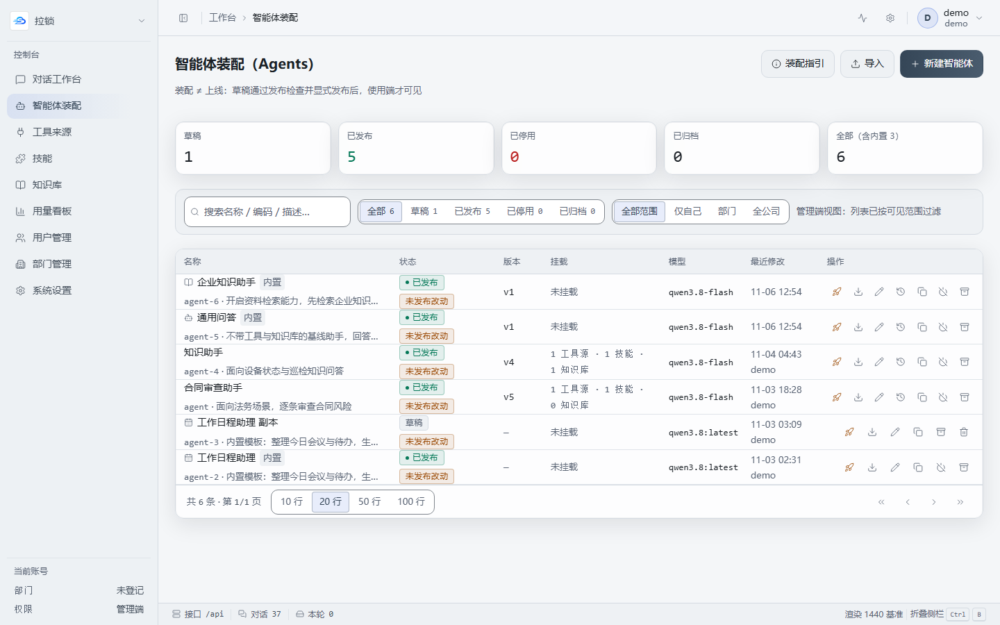
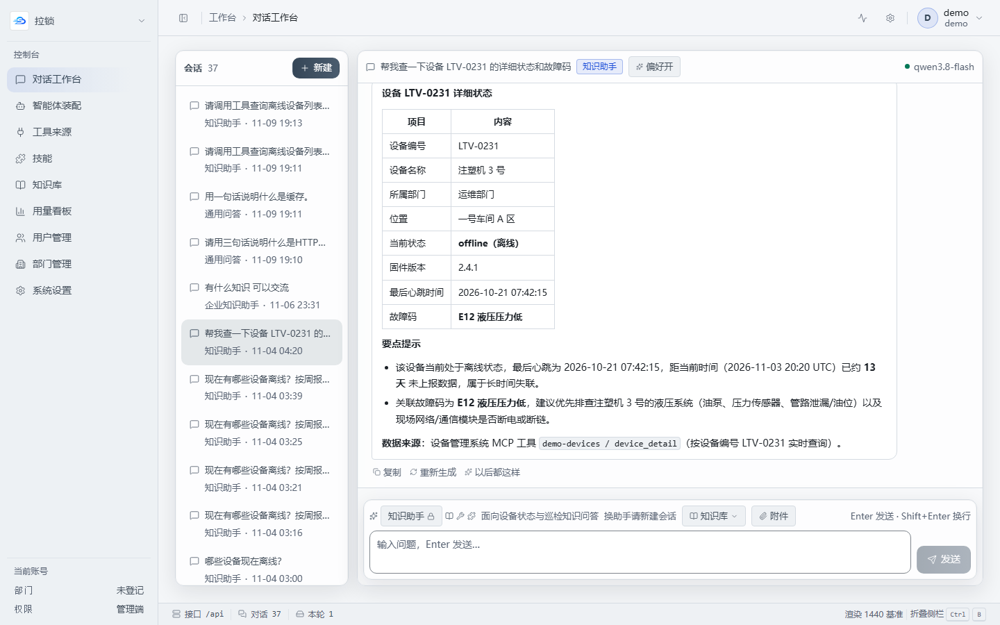
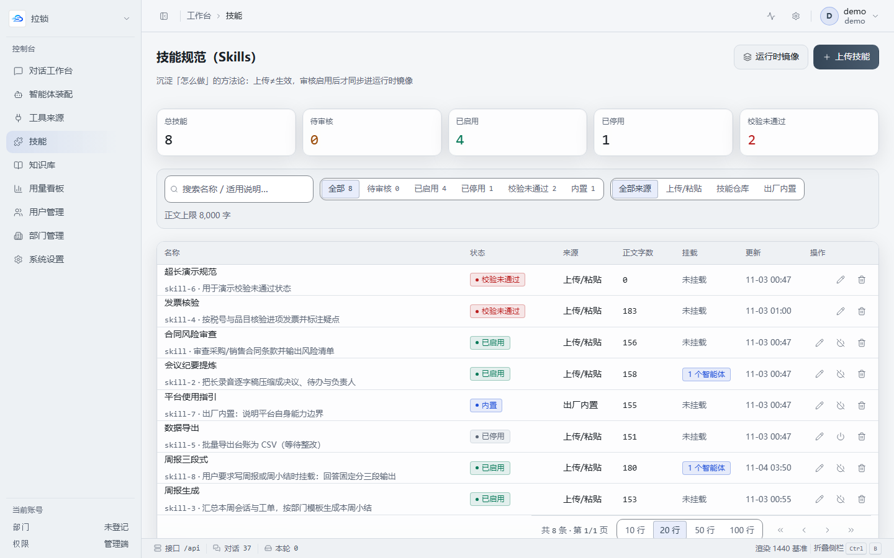
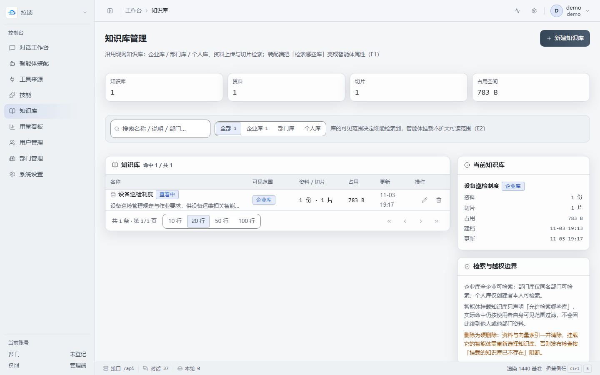
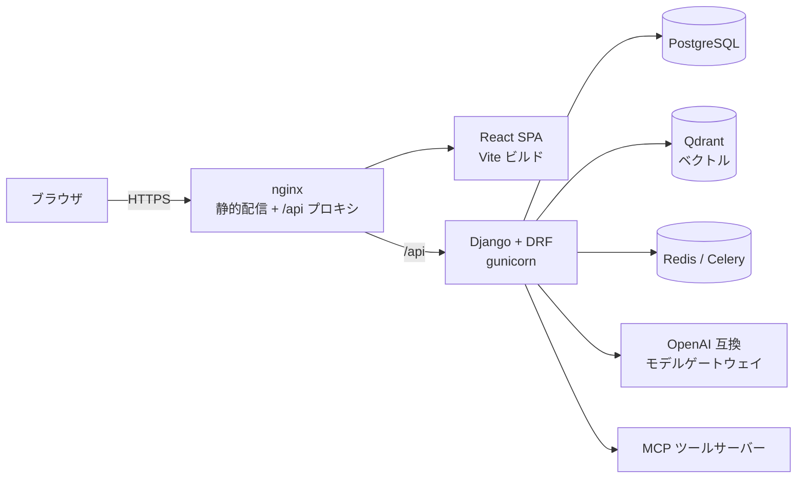

# Lasso — エンタープライズ・エージェント基盤

[English](README.md) · [简体中文](README.zh-CN.md) · [繁體中文](README.zh-TW.md) · **日本語** · [Русский](README.ru.md)

[](LICENSE)
[](frontend/package.json)
[](https://www.python.org/)
[](https://www.djangoproject.com/)
[](https://react.dev/)
[](https://vite.dev/)

**情報システム部門が承認できる形でセルフホストできるエージェント基盤：** バージョン管理された
エージェント、統制されたツール権限、段階的なスキル配信、そして「誰が何を変えたか」に答えられる
監査ログ。しかも Docker は不要です。

Lasso は企業向けのセルフホスト型エージェント管理基盤です。モデル、プロンプト、MCP ツール、
スキル、ナレッジベースを **バージョン管理された資産** として組み立て、公開前チェックを経て
リリースし、誰が利用できるか、どのバージョンが稼働しているか、各ツール呼び出しが何に触れたかを
記録し続けます。

> 以下のスクリーンショットはデモ用データセットで撮影したものです。画像内の UI 言語は中国語です。
> UI 文言はアプリ内でローカライズ可能で、画像はレイアウトと操作フローの説明を目的としています。

| エージェント構成 | チャットワークスペース |
|---|---|
|  |  |

| スキル | ナレッジベース |
|---|---|
|  |  |

---

## なぜ Lasso なのか

多くの「エージェント基盤」は、チャット画面と 1 つの API キーで止まっています。しかし本番運用に
入ると、問いは組織の課題になります。

- **このエージェントはどの部門に見せるべきか？** 公開範囲は既定で全社ではなく、絞り込める必要があります。
- **この書き込み系ツールを呼んでよいのか？** 権限はツールサーバー単位ではなく、ツール単位で付与すべきです。
- **誰かが設定を変えた。すでに本番に反映されているのか？** 編集と公開は別の操作であるべきです。
- **次の環境へどう移すのか？** モデルのキーや MCP のシークレットを持ち出さずに。
- **誰が変えたのか、実際に何をしたのか？** 監査ログは必須要件であり、加点要素ではありません。

Lasso はこれらの答えを、口約束ではなく製品機能として実装しています。

## 主要機能

| 機能 | 内容 |
|---|---|
| **バージョン管理されたエージェント** | モデル、プロンプト、ツール、スキル、ナレッジベースを 1 つのエージェントに構成。公開ごとに不変バージョンを生成し、フィールド単位の差分を表示します。未公開の変更が利用者に届くことはありません。 |
| **公開前チェック** | 公開前にブロック項目と警告項目のチェックリストを実行。バージョンのロールバックも同じチェックリストを通し、履歴を上書きせず新しいバージョンを生成します。 |
| **MCP ツール統制と外部通信スイッチ** | ツールソースを登録し、ツールを検出したうえで、ツール単位に 4 段階（許可リスト / 自動承認 / 毎回確認 / 読み取り専用）で認可します。プラットフォーム全体の外部通信スイッチとソース別ドメイン許可リストで、外部ネットワークへの到達可否を決めます。ツール呼び出しの本文はシークレットを除去して保存します。 |
| **機密情報のマスクと表示記録** | ツール呼び出しの引数と結果は原文のまま保存し、表示時にキー・トークン・パスワードなどをマスクします。原文の展開は明示的な操作で、操作者・対象フィールド・マスク件数を含む `sensitive_reveal` 監査ログを書き込むため、「見たのに記録がない」状態にはなりません。 |
| **スキルの段階配信と対象ユーザー指定** | スキルは `SKILL.md` パッケージとして審査します。公開範囲は部門スコープ、安定した割合配信（同一ユーザーは常に同じバケット）、ユーザー別許可リストの組み合わせで決まり、管理者は有効状態と配信割合を常に確認できます。 |
| **ナレッジベースと検索** | 文書の取り込み、チャンク化、ベクトル検索。各エージェントは利用可能なナレッジベースを宣言し、実際の検索結果は利用者自身の公開範囲でフィルタされます。 |
| **OCR による文書取り込み** | PDF と画像をページ単位で判定します。実際のテキスト層があるページはそのまま抽出し、テキスト層がない、または短すぎるページは OCR に回し、設定済みのマルチモーダルモデルを優先、ローカル tesseract をフォールバックにします。文書ごとに `extraction_report`（ページごとのテキスト層 / OCR / 未解決）を保持し、チャンクにはページ番号と OCR マーカーが付きます。全ページが失敗した文書は「完了」ではなく失敗として記録されます。 |
| **リソース単位のネットワークプロキシ** | プラットフォーム全体の HTTP / SOCKS5 プロキシ項目。パスワードは暗号化され、書き込み専用です。プロキシはリソース単位（SearXNG エンジン、天工の取得ドメイン、ソースサイト）でバインドします。適用時は現行の SearXNG 設定をバックアップして書き込み、再起動とヘルスチェックを行い、新しい設定が失敗した場合は直前の設定へ自動的にロールバックします。反映されなかったバインドは画面に明示されます。 |
| **女媧モード（一文からエージェント作成）** | 自然言語の要件から編集可能な骨子（名称、位置づけ、システムプロンプト、モデル階層、公開範囲、歓迎メッセージ）を生成し、公開 MCP ツールソースとスキルを照合、説明に沿って参考資料を取得してナレッジベースへ格納します。成果物は常に下書きで、各手順は中断・再開・修正できます。 |
| **ツール／スキルマーケット** | 「ツール」「スキル」の各ページに 2 つのタブ（ローカル一覧と公開マーケット検索）があります。マーケットは一覧・検索・ソースと信頼度による絞り込み・詳細カード・その場でのインポート申請に対応し、旧 `/market/*` は対応するタブへリダイレクトします。 |
| **天工モード（4 層の知識探索）** | 各ナレッジベースは厳密な順序で探索チェーンを実行します。**L1** 管理者が確認した MCP 検索バインディング、**L2** SearXNG（既定で有効）、**L3** Bing ヘッドレスブラウザのフォールバック（既定で無効、Playwright は任意）、**L4** 承認済みソースのクロール。検索層は候補提案だけを作成し、管理者が承認して初めてサイトがソースライブラリに入り本文を取得できます。クロールは robots.txt、Crawl-delay、公開 HTTPS とプライベートネットワークの検査、実行あたりのページ上限に従い、各実行でどの層が採用され他がなぜスキップされたかを記録します。 |
| **独立したナレッジ worker** | 文書解析、OCR、天工の収集は専用の `knowledge` Celery キューと専用 systemd worker で実行されるため、大きな取り込みが対話リクエストを圧迫しません。 |
| **エンドツーエンド監査** | 公開、ロールバック、インポート承認、権限変更、管理者によるパスワード再設定、ログイン事象、外部通信の判定などを、操作者・IP・User-Agent とともに監査ログへ記録します。 |
| **SSE ストリーミングチャット** | SSE によるストリーミング応答、ナレッジチャンクへの引用、ツール呼び出しのタイムライン、停止と再生成、会話履歴、添付ファイル、ターン単位のトークン集計。 |
| **環境間のエクスポート / インポート** | エクスポートパッケージにモデルのキー、MCP シークレット、トークンは含まれません。インポートは単一レベルの申請で、**別の管理者** の承認後にのみ書き込まれます。 |
| **部門ツリーと 2 段階ロール** | 部門階層、3 種類の公開範囲（全社 / 指定部門 / 管理側のみ）、一般ユーザーと管理者の厳格な区分。 |

## 女媧モードとツール／スキルマーケット

女媧モードは 1 段落の自然言語から実用的なエージェントの下書きを作ります。公開は代行しません。

| 手順 | 行われること | 編集可能 |
|---|---|---|
| 1. 説明 | 何をするか、誰が使うか、何を出力するかを書きます。 | 要件、利用対象、対象部門 |
| 2. 骨子 | 名称、slug、位置づけ、システムプロンプト、モデル階層、公開範囲、歓迎メッセージを生成します。 | すべての項目 |
| 3. ツールとスキル | 公開 MCP ツールソースとスキルを要件に照らして順位付けし、能力概要・外部通信の要否・スクリプトの有無・ライセンスを表示します。 | マウントする項目 |
| 4. 資料 | 参考ページをオンラインで取得し、整形・重複排除したうえで URL ごとの状態を表示し、確認後に書き込みます。 | 取り込むページ、対象ナレッジベース |
| 5. 下書き | **下書き**状態でエージェントを作成し、選択済みのマウントとナレッジベースを付けます。 | 構成画面のすべて |

**1 メニューに 2 タブ。**「ツール」（`/mcp`）と「スキル」（`/skills`）はそれぞれ、ローカル
ソース一覧と公開マーケットの 2 タブを持ちます。マーケットは一覧・検索・ソースと信頼度による絞り込み・
詳細カード・その場でのインポート申請に対応し、旧 `/market/mcp`、`/market/skills` は対応するタブへ
リダイレクトします。両タブはウィザード手順 3 と同じ検索サービスとインポート申請を使うため、ロジックも
承認基準も 1 系統だけです。

**オンライン優先、ローカルで代替。** `nuwa_market_online` は既定で有効です。検索は公開 registry と
スキルリポジトリへ直接アクセスし、ヒットした項目はローカルカタログにも書き込みます。ネットワーク
障害、タイムアウト、遮断、管理者によるスイッチ停止の場合はローカル副本に切り替え、`mode` を
`online` / `mixed` / `cached`、`degraded_reason` を `switch_off`、`timeout`、`network_error`、
`rate_limited`、`http_error`、`offline_no_cache` として理由と最終同期日を表示します。エラーにも
空画面にもなりません。

**独立した 2 系統のスイッチ。** 女媧の外部通信（`nuwa_market_online`、`nuwa_knowledge_online`）は市場
検索と資料取得だけを対象とします。実行中エージェントのツール外部通信（`mcp_egress_enabled`）は別の
スイッチで、片方を切っても他方に影響しません。管理者は `GET|POST /api/nuwa/switches/` で確認・変更
できます。

**承認基準は変わりません。** 公開マーケットの項目はすべて外部コンテンツです。インポートは単一レベル
の申請で、提出者が自分の申請を承認することはできません。承認された MCP ソースは `unknown` かつ
**全ツール無効**で保存され、スキルは `pending` で保存され審査通過まで実行時に載りません。女媧の
成果物は常に下書きで、公開時には通常の公開前チェックを通します。

```bash
# 公開マーケットからローカルカタログを更新（オンライン）
python manage.py nuwa_sync

# 外部接続のある環境で書き出し、イントラネット内で取り込む（外部通信なし）
python manage.py nuwa_sync --export data/nuwa/market-cache.json
python manage.py nuwa_sync --import data/nuwa/market-cache.json
```

## 天工モード：4 層の知識探索

天工（「天工開物」に由来）はナレッジベース単位の収集機能です。作成時に「関連知識を取得」を有効にすると
プラットフォームが自分で資料を集めます。スイッチは作成後も変更でき、以降の収集だけに影響します。

**4 層を 1 本のチェーンで。** 各実行は厳密な順序で進み、十分な有効結果が得られた層で停止します。

| 層 | 行うこと | 既定 |
|---|---|---|
| **L1 MCP 検索** | 管理者が登録済み MCP サーバーから明示的に確認した検索ツールを呼び出します。query / limit / 結果フィールドのマッピング、優先度、単体テストに対応し、特定ベンダーをハードコードせず、ツールを自動有効化しません。 | バインディング確認後に有効 |
| **L2 SearXNG** | ローカルの SearXNG JSON エンドポイントを照会します。タイムアウト、レート制限、サーキットブレーカー付きです。 | 有効 |
| **L3 Bing フォールバック** | Playwright で駆動するヘッドレス Chromium が Bing のみを照会します。他のエンジンの解析や、CAPTCHA・リスク制御の回避は行いません。CAPTCHA や HTTP 429 は失敗として記録し、24 時間のサーキットを開きます。ブラウザは任意のデプロイ前提で、本層は既定で無効、利用できない場合は理由付きでスキップします。 | 無効 |
| **L4 ソースライブラリ** | 承認済みソースとナレッジベースの一時シード URL を取得します。robots.txt と Crawl-delay を守り、ホストごとに直列、URL と本文フィンガープリントで重複排除、実行あたりのページ上限を設けます。 | 有効 |

**検索は提案だけを生み、文書は生みません。** L1–L3 は `TiangongSourceProposal`（`discovered_by` は
`mcp` / `searxng` / `bing`）だけを書き込みます。管理者が 1 件ずつ承認または拒否し、承認時に
`TiangongSource` を作成または統合します。L4 で取得されるのは有効なソースだけなので、未承認の URL が
ナレッジベースへ取り込まれることはありません。各実行は `TiangongRun` にフォールバックチェーン（層、
結果、理由、件数、所要時間）と 1 件の集約監査を記録し、URL ごとの行は作りません。

**プライベートネットワーク防御。** 候補 URL は公開 HTTPS である必要があります。DNS は IPv4 のみで
解決し、プライベート、ループバック、リンクローカル、イントラネットのホストを拒否します。実接続時にも
同じ検査を行います。プロキシを設定する場合はリソース単位（SearXNG エンジン、天工の取得ドメイン、
ソースサイト）でバインドし、パスワードは暗号化して読み取り API にも監査ログにも出しません。

**上限と説明可能性。** 1 回の実行で最大 5 ページとモデル整理稿 1 件まで。以降は手動で「追加収集」を
実行します。モデル整理稿は `source_type='model'` と生成モデル名を持ち、原典の引用としては表示しません。
外部接続なし → モデル側のみ。モデル未設定 → ウェブ側のみ。スイッチ停止 → 理由付きでスキップ。
両方不可 → 失敗として可読な理由を記録。ナレッジベースは利用可能なままで、500 は返しません。

**権限と独立したスイッチ。** スイッチの変更と実行は所有者または管理者のみです。`tiangong_enabled`、
`tiangong_online` と各検索層のスイッチは天工専用で、`nuwa_market_online` /
`nuwa_knowledge_online` を参照せず、ツールの外部通信 `mcp_egress_enabled` とも独立です。共有するのは
ドメイン許可リストという安全境界だけです。管理者は `GET|POST /api/knowledge/tiangong/switches/` で
全体スイッチを、`GET|POST /api/knowledge/tiangong-search/settings/` で検索層を操作します。

## アーキテクチャ



| レイヤー | 技術 |
|---|---|
| フロントエンド | React 19.2、TypeScript 6、Vite 8.3、Tailwind CSS 4.3、TanStack Query 5、Zustand 5 |
| バックエンド | Django 5.2（5.2.17）、Django REST Framework 3.18、SimpleJWT、gunicorn 23 |
| データ | PostgreSQL 14+（ローカル開発では SQLite）、Qdrant 1.19（任意）、Redis / Celery（任意） |
| 連携 | OpenAI Chat Completions 互換の任意のゲートウェイ、MCP ツールサーバー |

`backend/apps/` には 11 個の Django モジュールがあり、`agenthub`、`agents`、`chat`、`skills`、
`knowledge`、`mcp`、`nuwa`、`users`、`settings`、`usage` と共通ヘルパーの `common` が
ドメインロジックを担います。

## クイックスタート（5 分）

**前提条件：** Python 3.11+、Node.js 20+、データベースは既定の SQLite または PostgreSQL 14+。
開始時点で Docker、メッセージブローカー、ベクトルデータベースは不要です。

### 1. バックエンドのインストール

```bash
python -m venv .venv
source .venv/bin/activate          # Windows: .venv\Scripts\activate
pip install -r requirements.txt
```

### 2. データベースの初期化

```bash
cp .env.example .env               # 実際の値に編集
python manage.py migrate
python manage.py createsuperuser
python manage.py init_builtin_agents   # 任意：組み込みエージェントを投入
```

### 3. API の起動

```bash
python manage.py runserver 127.0.0.1:8000
```

### 4. コンソールの起動

```bash
cd frontend
npm ci
npm run dev                        # http://localhost:5173、/api は :8000 へプロキシ
```

<http://localhost:5173> を開き、作成した管理者アカウントでサインインします。

### 5. 最初のエージェントを構成する

1. **エージェント構成** を開き、**新規エージェント** を選択します。
2. モデルを選択し（先に **システム設定** でゲートウェイを設定・検証）、プロンプトを書き、
   必要なツール、スキル、ナレッジベースをマウントします。
3. 公開前チェックを実行して公開し、不変の新バージョンがバージョン一覧に現れることを確認します。
4. **チャットワークスペース** でそのエージェントを選び、最初のメッセージを送ります。回答、
   引用元、ツール呼び出しのタイムラインが会話に残ります。

本番ビルドは `cd frontend && npm run build` を実行し、`frontend/dist` を nginx で配信します。

### 6. 女媧モードと統合後のマーケットを試す

1. サイドバーのカタログ入口は **ツール** と **スキル** の 2 つだけです。各ページにローカル一覧と公開
   マーケットの 2 タブがあり、旧 `/market/mcp`、`/market/skills` は対応するタブへリダイレクトします。
2. **エージェント構成**で**女媧モード**を選び、要件を 1 段落で書いて 5 つの手順を進めます：
   骨子 → ツールとスキル → 参考資料 → 下書き。
3. 公開マーケットから選んだ項目は**承認待ち**になり、別の管理者の承認が必要です。MCP ソースは
   `unknown` かつ全ツール無効、スキルは `pending` で保存されます。
4. 外部接続のないホストでは、接続のある環境でカタログを書き出してイントラネット内で取り込みます。
   マーケットタブはローカル副本で動作を続け、降級理由を表示します。

```bash
python manage.py nuwa_sync                                        # オンライン更新
python manage.py nuwa_sync --export data/nuwa/market-cache.json   # 外部接続のあるホスト
python manage.py nuwa_sync --import data/nuwa/market-cache.json   # イントラネット内
```

### 7. 天工モードを試す

1. **ナレッジ**で**新規ナレッジベース**を選び、**関連知識を取得**（天工モード）を有効にします。
2. **収集トピック**（任意。既定は名称と説明）と**収集入口**（任意、最大 5 URL）を入力して保存すると、
   初回収集が自動で始まります。
3. 天工ページの 3 タブを確認します。**ソースライブラリ**（承認済みソース）、**候補ソース**（承認待ちの
   提案）、**検索と取得**（各層のスイッチとパラメータ）。L2 SearXNG は既定で有効、L1 は MCP 検索
   バインディングの確認が必要、L3 Bing は既定で無効で、ホストに任意の Playwright ブラウザを入れた場合
   だけ使えます。
4. 信頼できる候補を承認します。次回の実行は承認済みソースだけを取得して本文を取り込み、各文書には
   「外部ウェブ」または「モデル生成」が付きます。
5. 検索層が失敗しても、実行記録にその層と理由が残り、ソースライブラリの取得は継続します。天工の
   スイッチは女媧の外部通信スイッチと独立です。


## 設定

実行時の設定はすべて環境変数、またはローカルの `.env` から読み込みます。
[`.env.example`](.env.example) をコピーして値を埋めてください。このファイルはプレースホルダのみを
含み、各変数の意味を説明し、実在のホスト・キー・アカウントは意図的に含んでいません。

| グループ | 変数 | 補足 |
|---|---|---|
| 基本 | `SECRET_KEY`、`DEBUG`、`ALLOWED_HOSTS`、`ALLOW_REGISTER` | `SECRET_KEY` は環境ごとに一意にする |
| 認証 | `JWT_SIGNING_KEY`、`JWT_*_LIFETIME_*`、`LOGIN_FAILURE_*`、`AUTH_TRUSTED_PROXIES` | 署名キーをローテーションすると既存トークンは無効になる |
| データベース | `DB_ENGINE`、`DB_NAME`、`DB_USER`、`DB_PASSWORD`、`DB_HOST`、`DB_PORT` | 既定は `sqlite3`、共用環境では PostgreSQL を推奨 |
| 保存時暗号化 | `MCP_SECRET_KEY` | 保存された MCP 認証情報を暗号化。エクスポートには含まれない |
| 検索 | `VECTOR_STORE`、`QDRANT_*`、`FASTEMBED_*` | ローカル開発では Qdrant 不要 |
| 非同期 | `CELERY_BROKER_URL`、`CELERY_RESULT_BACKEND`、`CELERY_TASK_*` | ブローカーなしでも eager モードで動作 |
| モデル | `LLM_BASE_URL`、`LLM_API_KEY`、`LLM_MODEL`、`LLM_*` | OpenAI 互換ゲートウェイ。管理画面からも設定可能 |

## 一般的な構成との比較

比較は定性的なもので、本プロジェクトが重視する能力軸に限定しています。最初の 2 列はそうした
アプローチの **典型的な形態** を指し、特定製品を対象としたものではありません。

| 観点 | 典型的なチャット型エージェントフレームワーク | 典型的な SaaS 型エージェント基盤 | Lasso |
|---|---|---|---|
| 公開前チェック付きのバージョン管理 | — | 一部 | 対応 |
| ツール単位の認可と外部通信スイッチ | — | 一部 | 対応 |
| スキルの配信割合とユーザー別許可リスト | — | — | 対応 |
| 製品内の部門スコープ公開範囲 | — | 一部 | 対応 |
| 別の管理者の承認を要するインポート | — | — | 対応 |
| 公開・権限・外部通信を網羅する監査ログ | 一部 | 一部 | 対応 |
| Docker なしで自社ホストに導入 | 対応 | 非対応 | 対応 |
| 差し替え可能なモデルゲートウェイ | 対応 | 一部 | 対応 |

## デプロイ形態

リファレンス構成はベアメタルです。**nginx** が静的配信と `/api` のリバースプロキシを担当し、
**gunicorn** を **systemd** で管理、データベースは **PostgreSQL 14+**、Redis / Celery と Qdrant は
必要に応じて有効化します。**Docker は不要で、使用しません。**

- `deploy/nginx/` —— API とメディアの server 断片、およびリファレンス `nginx.conf`。
- `deploy/systemd/lasso.service` —— 再起動ポリシーと journald ログを含む gunicorn のユニット。
- `deploy/systemd/lasso-knowledge-worker.service` —— `knowledge` キュー専用 worker（解析、OCR、天工収集）。
- `deploy/searxng/` —— L2 用 SearXNG のインストールと設定のリファレンス。
- `deploy/ops/install_ocr.sh` —— 任意のローカル tesseract OCR フォールバック。
- `deploy/install_playwright.sh` —— L3 Bing フォールバック用の任意の Playwright + Chromium 前提。
- [docs/DEPLOYMENT.md](docs/DEPLOYMENT.md) —— 手順ごとの設定、移行、トラブルシューティング。

## プロジェクト構成

```
agent-platform/
├── backend/                 Django プロジェクト
│   ├── apps/agenthub/       エージェント、バージョン、公開、インポート申請
│   ├── apps/agents/         実行時、ツールレジストリ、ブリッジ
│   ├── apps/chat/           会話、ストリーミング、ツール呼び出し
│   ├── apps/skills/         スキルパッケージ、配信、マウント
│   ├── apps/knowledge/      ナレッジベース、文書、検索、天工の探索、OCR
│   ├── apps/mcp/            ツールソース、検出、認証情報、デモサーバー
│   ├── apps/users/          アカウント、部門、監査ログ
│   ├── apps/settings/       プラットフォーム設定とモデル接続確認
│   ├── apps/usage/          トークン使用量と分析
│   ├── apps/nuwa/          女媧モード：マーケットカタログ、ウィザードセッション、インポート申請
│   └── apps/common/         共通のモデル・埋め込み・メディア処理
├── frontend/                React + Vite の SPA
│   └── src/pages/           エージェント（女媧を含む）、チャット、ツール（市場を含む）、スキル（市場を含む）、ナレッジ、ユーザー、設定
├── deploy/                  nginx、systemd、SearXNG、OCR / Playwright の補助スクリプト
├── docs/                    API リファレンス、権限マトリクス、デプロイガイド、スクリーンショット
├── .env.example             設定テンプレート
└── requirements.txt
```

## ドキュメント索引

| ドキュメント | 内容 |
|---|---|
| [docs/DEPLOYMENT.md](docs/DEPLOYMENT.md) | 本番デプロイ、設定、トラブルシューティング |
| [docs/api-reference.md](docs/api-reference.md) | REST API のエンドポイントリファレンス |
| [docs/auth-permission-matrix.md](docs/auth-permission-matrix.md) | 認証、ロール、オブジェクト単位の権限 |
| [docs/assets/screenshots/README.md](docs/assets/screenshots/README.md) | スクリーンショットの撮影・マスキング基準 |
| [CONTRIBUTING.md](CONTRIBUTING.md) | 変更提案とプルリクエストの手順 |
| [SECURITY.md](SECURITY.md) | 脆弱性の非公開報告とハードニング項目 |
| [CODE_OF_CONDUCT.md](CODE_OF_CONDUCT.md) | コミュニティの行動規範と対応 |
| [docs/design/nuwa-mode.md](docs/design/nuwa-mode.md) | 女媧モードとマーケットの設計：スイッチ、降級経路、承認基準（中国語） |
| [.env.example](.env.example) | 対応する環境変数の一覧（プレースホルダのみ） |

## コントリビューション

コントリビューションを歓迎します。[CONTRIBUTING.md](CONTRIBUTING.md) と
[行動規範](CODE_OF_CONDUCT.md) をご確認ください。脆弱性は [SECURITY.md](SECURITY.md) に記載の
方法で非公開に報告し、公開 issue には書かないでください。

## ライセンス

**Apache License 2.0** で提供されます。全文は [LICENSE](LICENSE) を参照してください。

- 商用利用、改変、配布、私的利用が可能です。
- 著作権表示、ライセンス本文、同梱の `NOTICE` ファイルを保持し、改変したファイルには変更内容を
  明示する必要があります。
- 本ソフトウェアは**いかなる保証もなく**提供され、作者は損害に対して責任を負いません。
- Apache-2.0 は明示的な特許ライセンスを付与する一方、本プロジェクトの商標を派生製品の推奨に
  使用しないことを求めます。

Copyright 2026 Lasso contributors.