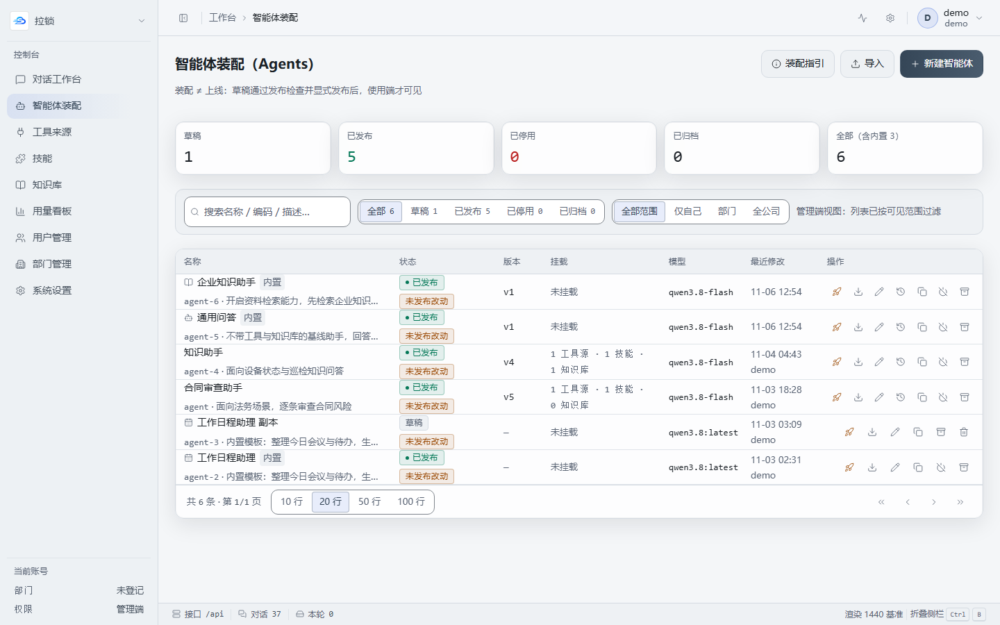
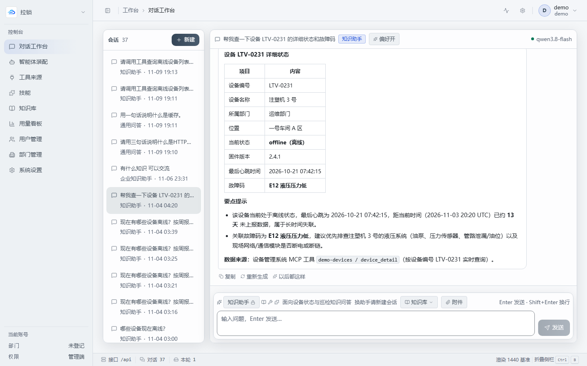
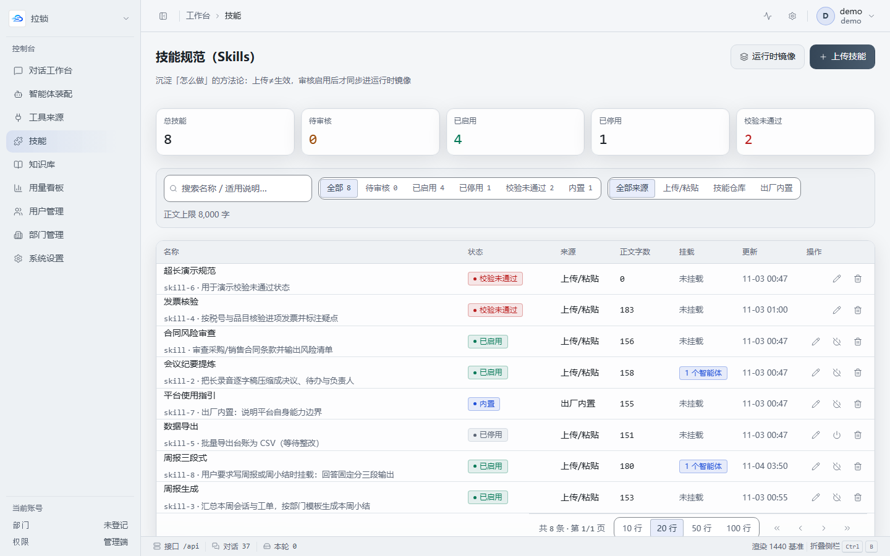
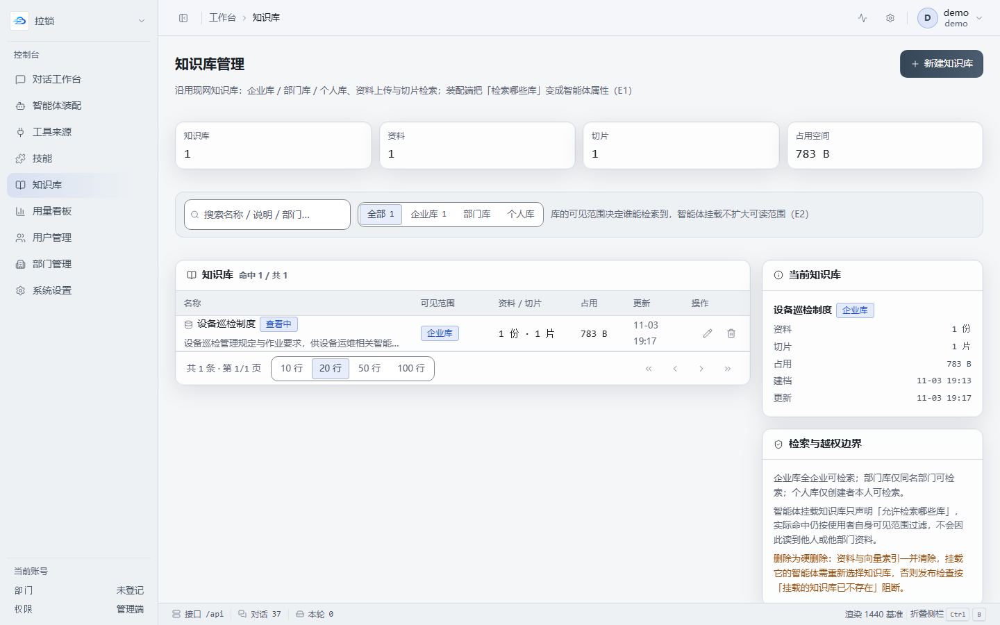
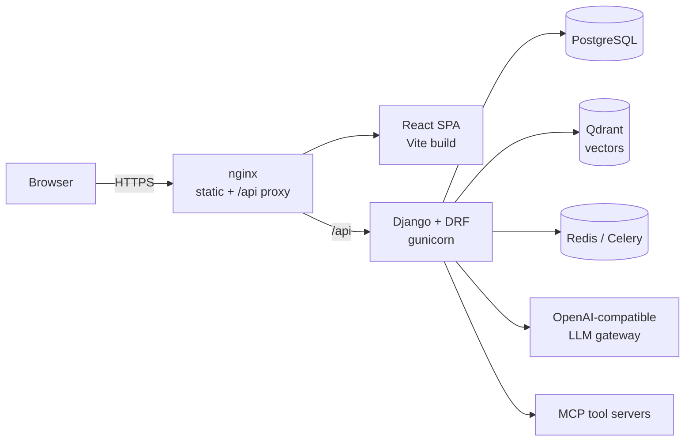

# Lasso — Enterprise Agent Platform

**English** · [简体中文](README.zh-CN.md) · [繁體中文](README.zh-TW.md) · [日本語](README.ja.md) · [Русский](README.ru.md)

[](LICENSE)
[](frontend/package.json)
[](https://www.python.org/)
[](https://www.djangoproject.com/)
[](https://react.dev/)
[](https://vite.dev/)

**Self-host an agent platform your IT department can actually approve:** versioned agents, governed
tools, staged skill rollout and an audit trail that answers "who changed what" — without Docker.

Lasso is a self-hosted control plane for enterprise agents. It composes a model, a prompt, MCP
tools, skills and knowledge bases into a **versioned asset**, publishes it through review checks,
and keeps track of who may use it, which version is live, and what every tool call touched.

> The screenshots below show the product with a demo dataset. The interface language in the images
> is Chinese; interface strings are localisable in the app — the images illustrate layout and flow.

| Agent assembly | Chat |
|---|---|
|  |  |

| Skills | Knowledge base |
|---|---|
|  |  |

---

## Why Lasso

Most "agent platforms" stop at a chat box wired to one API key. Once an agent reaches production,
the real questions are organisational:

- **Which department may see this agent?** Visibility has to be scoped, not global by default.
- **May it call this write-capable tool?** Tool access has to be granted per tool, not per server.
- **Someone edited it — is that live?** Editing and publishing must be separate acts.
- **How do we move it to the next environment?** Without shipping model keys and MCP secrets along.
- **Who changed it, and what did it do?** An audit trail is a requirement, not a nice-to-have.

Lasso turns those questions into product features instead of verbal agreements.

## Capability matrix

| Capability | What it does |
|---|---|
| **Versioned agents** | Model, prompt, tools, skills and knowledge bases are assembled into one agent. Every publish creates an immutable version with a field-level diff; unpublished edits never reach users. |
| **Pre-publish checks** | A blocking / warning checklist runs before an agent goes live. Version rollback re-runs the same checklist and produces a new version instead of rewriting history. |
| **MCP tool governance & egress switch** | Register tool sources, discover their tools, then authorise tool by tool with four tiers (allow-list, auto-approve, ask-every-time, read-only). A platform-level egress switch and per-source domain allow-lists decide whether an agent may reach the outside network at all; tool-call bodies are stored with secrets stripped. |
| **Masked sensitive content with reveal audit** | Tool-call arguments and results keep their original values in storage but are rendered with keys, tokens and passwords masked. Revealing the original is an explicit action that writes a `sensitive_reveal` audit entry with actor, target field and masked-field count, so "looked at it but no trace" cannot happen. |
| **Skill rollout & targeted users** | Skills are `SKILL.md` packages under review. Visibility combines department scope, a stable percentage rollout (same user, same bucket) and a per-user allow-list; an administrator can always see what is enabled and at what percentage. |
| **Knowledge bases & retrieval** | Document ingestion, chunking and vector search. Each agent declares which knowledge bases it may retrieve from; the effective result set is still filtered by the caller's own visibility. |
| **OCR document ingestion** | PDFs and images are checked page by page: a real text layer is used as-is; missing or too-short pages go to OCR, the configured multimodal model first and local tesseract as fallback. Each document keeps an `extraction_report` (text layer / OCR / unresolved per page) and chunks carry page and OCR markers; a document whose pages all fail is marked failed instead of completing with zero chunks. |
| **Per-resource network proxies** | Platform-level HTTP / SOCKS5 proxy entries with encrypted, write-only passwords. A proxy is bound per resource — a SearXNG engine, a Tiangong crawl domain or a source site. Applying writes the binding into the live SearXNG configuration with a backup, restarts the service, health-checks it, and rolls back to the previous configuration when the new one fails; bindings that did not take effect are marked in the UI. |
| **Nüwa mode (agents from a paragraph)** | A natural-language brief becomes an editable skeleton (name, positioning, system prompt, model tier, visibility, welcome message), matched against public MCP tool sources and skills, and enriched with reference material fetched into a knowledge base. The output is always a draft; every step is resumable and editable. |
| **Tool & skill market** | The **Tools** and **Skills** pages each carry two tabs: the local source list and public market search. The market lists, searches and filters the catalogue (source, trust, egress need, scripts, licence), opens a detail view and submits an import request in place; old `/market/*` links redirect to the matching tab. |
| **Tiangong mode (four-layer discovery)** | Each knowledge base runs a bounded discovery chain: **L1** administrator-confirmed MCP search bindings, **L2** SearXNG (on by default), **L3** a Bing headless-browser fallback (off by default, optional Playwright), then **L4** crawling approved sources. Search layers only create candidate proposals; an administrator approves a proposal before its site joins the source library and can be crawled. Crawls obey robots.txt, Crawl-delay, public-HTTPS / private-network checks and per-run page caps, and every run records which layer answered and why the others were skipped. |
| **Isolated knowledge worker** | Document parsing, OCR and Tiangong collection run on a dedicated `knowledge` Celery queue with its own systemd worker, so a large ingestion job cannot starve interactive requests. |
| **End-to-end audit** | Every privileged action — publishing, rollback, import approval, permission change, admin password reset, sign-in events, egress decisions — is written to an audit log with actor, IP and user agent. |
| **SSE streaming chat** | Streaming answers over SSE, citations back to knowledge chunks, tool-call timeline, stop and regenerate, conversation history, attachments and per-turn token accounting. |
| **Cross-environment export / import** | Export packages never contain model keys, MCP secrets or tokens. Import is a single-level request that a **second administrator** must approve before anything is written. |
| **Department tree & two-tier roles** | Department hierarchy, three visibility scopes (company-wide, department, admin-only) and a strict normal-user / administrator split. |

## Nüwa mode and the tool/skill market

Nüwa mode turns one paragraph of plain language into a working agent draft. It never publishes for you.

| Step | What happens | Editable |
|---|---|---|
| 1. Describe | You write what the agent does, who it serves and what it must output. | Brief, audience, department |
| 2. Skeleton | Name, slug, positioning, system prompt, model tier, visibility and welcome message are generated. | Every field |
| 3. Tools & skills | Public MCP tool sources and skills are matched against the brief and ranked; each candidate shows its capability summary, whether it needs egress, whether it ships scripts, and its licence. | Which items to mount |
| 4. Knowledge | Reference pages are fetched online, cleaned, de-duplicated and shown with a per-URL status before anything is written. | Which pages to import, target knowledge base |
| 5. Draft | An agent is created in **draft** status with the selected mounts and knowledge base. | Everything, in agent assembly |

**One entry per catalogue, two tabs.** `Tools` (`/mcp`) and `Skills` (`/skills`) each carry two tabs —
the local source list and the public market. The market tab lists, searches and filters the catalogue by
source and trust, opens a detail card and submits an import request in place. Old `/market/mcp` and
`/market/skills` links redirect to the matching tab. Both tabs call the same retrieval service and the same
import request as step 3 of the wizard, so there is only one code path and one approval rule.

**Online first, local fallback.** `nuwa_market_online` is on by default: retrieval goes straight to the
public registry and skill repository, and every hit is also written to the local catalogue. When the
network fails, times out, is blocked, or an administrator turns the switch off, the pages fall back to
the local copy and label it — `mode` is `online`, `mixed` or `cached`, and `degraded_reason` explains why
(`switch_off`, `timeout`, `network_error`, `rate_limited`, `http_error`, `offline_no_cache`) together with
the last sync date. They never error out or go blank.

**Two independent switch families.** Nüwa egress (`nuwa_market_online`, `nuwa_knowledge_online`) only
covers market retrieval and reference fetching. Tool egress for running agents (`mcp_egress_enabled`)
is a separate switch: turning one off never affects the other. Administrators can read or change the
Nüwa switches at `GET|POST /api/nuwa/switches/`.

**Unchanged approval boundary.** Everything from the public market is external content. An import
request is single-level and the submitter can never approve their own request. An approved MCP source is
stored as `unknown` with **all tools disabled**; an approved skill is stored as `pending` and stays out
of the runtime until it passes review. Nüwa output is always a draft — publishing still runs the normal
pre-publish checklist.

```bash
# Refresh the local catalogue from the public market (online)
python manage.py nuwa_sync

# Export the catalogue where there is internet access, then import it inside the intranet
python manage.py nuwa_sync --export data/nuwa/market-cache.json
python manage.py nuwa_sync --import data/nuwa/market-cache.json
```

## Tiangong mode: four-layer knowledge discovery

Tiangong ("天工开物") is a per-knowledge-base collector. Turn on **Fetch related knowledge** when creating
a knowledge base and the platform discovers material by itself; switches can be changed later and only
affect subsequent runs.

**Four layers, one chain.** Each run walks a strict order and stops at the first layer that returns enough
usable results:

| Layer | What it does | Default |
|---|---|---|
| **L1 — MCP search** | Calls search tools that an administrator explicitly bound from registered MCP servers, with query / limit / result field mapping, priority and a per-binding test. No vendor is hard-coded and no tool is enabled automatically. | Off until a binding is confirmed |
| **L2 — SearXNG** | Queries a local SearXNG JSON endpoint with timeouts, rate limits and a circuit breaker. | On |
| **L3 — Bing fallback** | A headless Chromium driven by Playwright queries Bing only. It does not parse other engines and never bypasses captchas or risk controls: a captcha or HTTP 429 is recorded as a failure and opens a 24-hour circuit. The browser is an optional deployment prerequisite, the layer is off by default, and it is skipped with a readable reason when unavailable. | Off |
| **L4 — Source library** | Crawls approved sources plus the knowledge base's temporary seed URLs, following robots.txt and Crawl-delay, one page at a time per host, with URL and content-fingerprint deduplication and a per-run page cap. | On |

**Search produces proposals, not documents.** L1–L3 only write `TiangongSourceProposal` rows
(`discovered_by` = `mcp` / `searxng` / `bing`). An administrator approves or rejects each proposal;
approval creates or merges a `TiangongSource`. Only enabled sources are crawled in L4, so an unapproved URL
is never fetched into the knowledge base. Each run stores a `TiangongRun` with its fallback chain (layer,
result, reason, count, elapsed time) and one aggregate audit entry — never one row per URL.

**Private-network guard.** Candidate URLs must be public HTTPS. DNS is resolved over IPv4 only; private,
loopback, link-local and intranet hosts are rejected, and the same check is applied again at connection
time. Proxies, when configured, are bound per resource — a SearXNG engine, a Tiangong crawl domain or a
source site — with encrypted passwords that are never returned or written to the audit log.

**Bounded and explainable.** A run adds at most 5 web pages and 1 model brief; later runs are started by
hand. Model-written briefs carry `source_type='model'` and the generating model name, and are never
presented as original citations. No network → model side only; model not configured → web side only;
switch off → the run is skipped with a reason; both unavailable → the run is marked failed with a readable
message. The knowledge base stays usable and no request returns 500.

**Permissions and independent switches.** Only the owner or a platform administrator can toggle or trigger
a run. `tiangong_enabled`, `tiangong_online` and the search-layer switches govern Tiangong only; they do
not read `nuwa_market_online` / `nuwa_knowledge_online`, and tool egress (`mcp_egress_enabled`) is separate
again; only the domain allow-list is shared as a security boundary. Administrators manage the switches at
`GET|POST /api/knowledge/tiangong/switches/` and the search layers at
`GET|POST /api/knowledge/tiangong-search/settings/`.

## Architecture



| Layer | Stack |
|---|---|
| Frontend | React 19.2, TypeScript 6, Vite 8.3, Tailwind CSS 4.3, TanStack Query 5, Zustand 5 |
| Backend | Django 5.2 (5.2.17), Django REST Framework 3.18, SimpleJWT, gunicorn 23 |
| Data | PostgreSQL 14+ (SQLite for local development), Qdrant 1.19 (optional), Redis / Celery (optional) |
| Integration | Any OpenAI-compatible chat-completions gateway, MCP tool servers |

Eleven Django modules under `backend/apps/` carry the domain logic: `agenthub`, `agents`, `chat`,
`skills`, `knowledge`, `mcp`, `nuwa`, `users`, `settings`, `usage` and the shared `common` helpers.

## Quick start (5 minutes)

**Requirements:** Python 3.11+, Node.js 20+, and either SQLite (default) or PostgreSQL 14+.
No Docker, no external message broker, and no vector database are required to get started.

### 1. Install the backend

```bash
python -m venv .venv
source .venv/bin/activate          # Windows: .venv\Scripts\activate
pip install -r requirements.txt
```

### 2. Initialise the database

```bash
cp .env.example .env               # then edit the values
python manage.py migrate
python manage.py createsuperuser
python manage.py init_builtin_agents   # optional: seed the built-in agents
```

### 3. Start the API

```bash
python manage.py runserver 127.0.0.1:8000
```

### 4. Start the console

```bash
cd frontend
npm ci
npm run dev                        # http://localhost:5173, proxies /api to :8000
```

Open <http://localhost:5173> and sign in with the superuser you just created.

### 5. Assemble your first agent

1. Open **Agents** and choose **New agent**.
2. Pick a model (configure the gateway under **Settings** first), write the prompt, and mount the
   tools, skills and knowledge bases the agent should have.
3. Run the pre-publish checklist, publish, and confirm the new immutable version appears.
4. Open **Chat**, select the agent and send the first message; the answer, its citations and the
   tool-call timeline are recorded in the conversation.

For a production build, run `cd frontend && npm run build` and serve `frontend/dist` from nginx.

### 6. Try Nüwa mode and the merged market

1. The sidebar has exactly two catalogue entries: **Tools** and **Skills**. Each page carries two tabs —
   the local list and the public market; old `/market/mcp` and `/market/skills` links redirect to the
   matching tab.
2. On **Agents**, choose **Nüwa mode**, describe the agent in one paragraph and walk the five steps:
   skeleton → tools and skills → reference material → draft.
3. External items you pick stay **pending** until another administrator approves them; MCP sources land
   as `unknown` with every tool disabled, skills land as `pending`.
4. On an air-gapped host, export the catalogue where there is internet access and import it inside the
   intranet; the market tabs keep working from the local copy and label the degraded mode.

```bash
python manage.py nuwa_sync                                        # online refresh
python manage.py nuwa_sync --export data/nuwa/market-cache.json   # on a connected host
python manage.py nuwa_sync --import data/nuwa/market-cache.json   # inside the intranet
```

### 7. Try Tiangong mode

1. On **Knowledge**, choose **New knowledge base** and turn on **Fetch related knowledge** (Tiangong).
2. Fill **Topics** (optional; defaults to the name and description) and **Seed URLs** (optional, up to 5),
   then save. The first run starts automatically.
3. Open the Tiangong page and review the three tabs: **Sources** (the approved source library),
   **Candidates** (pending proposals) and **Search & crawl** (layer switches and parameters). L2 SearXNG is
   on by default; L1 needs an approved MCP search binding; L3 Bing stays off unless the optional Playwright
   browser is installed on the host.
4. Approve the candidates you trust. The next run crawls approved sources only and imports the body text;
   every document is tagged **External web page** or **Model generated**.
5. If a search layer fails, the run records that layer and its reason and still crawls the source library.
   Tiangong switches are independent of the Nüwa egress switches.


## Configuration

Runtime configuration comes from environment variables or a local `.env`. Copy
[`.env.example`](.env.example) and fill in your own values; it documents every variable with
placeholders only and intentionally contains no real hosts, keys or accounts.

| Group | Variables | Notes |
|---|---|---|
| Core | `SECRET_KEY`, `DEBUG`, `ALLOWED_HOSTS`, `ALLOW_REGISTER` | `SECRET_KEY` must be unique per deployment |
| Auth | `JWT_SIGNING_KEY`, `JWT_*_LIFETIME_*`, `LOGIN_FAILURE_*`, `AUTH_TRUSTED_PROXIES` | Rotating the signing key invalidates existing tokens |
| Database | `DB_ENGINE`, `DB_NAME`, `DB_USER`, `DB_PASSWORD`, `DB_HOST`, `DB_PORT` | `sqlite3` by default; PostgreSQL recommended |
| Secrets at rest | `MCP_SECRET_KEY` | Encrypts stored MCP credentials; never exported |
| Retrieval | `VECTOR_STORE`, `QDRANT_*`, `FASTEMBED_*` | Qdrant optional for local development |
| Async | `CELERY_BROKER_URL`, `CELERY_RESULT_BACKEND`, `CELERY_TASK_*` | Eager mode works without a broker |
| LLM | `LLM_BASE_URL`, `LLM_API_KEY`, `LLM_MODEL`, `LLM_*` | Any OpenAI-compatible gateway; can also be set in the admin UI |

## How Lasso compares

The comparison is qualitative and reflects the capability dimensions this project focuses on. The
first two columns describe **typical forms** of those approaches, not any specific product.

| Dimension | Typical chat-only agent framework | Typical hosted SaaS agent platform | Lasso |
|---|---|---|---|
| Versioned agent releases with pre-publish checks | — | Partial | Yes |
| Per-tool authorisation and platform egress switch | — | Partial | Yes |
| Skill rollout percentage and per-user allow-list | — | — | Yes |
| Department-scoped visibility in the product | — | Partial | Yes |
| Import that needs a second administrator | — | — | Yes |
| Audit log covering publishing, permissions and egress | Partial | Partial | Yes |
| Runs on your own host without Docker | Yes | No | Yes |
| Model gateway you can swap | Yes | Partial | Yes |

## Deployment shape

The reference deployment is bare metal: **nginx** for static assets and `/api` proxying,
**gunicorn** under **systemd**, **PostgreSQL 14+**, and optionally Redis / Celery and Qdrant.
Docker is neither required nor used.

- `deploy/nginx/` — server blocks for the API and media endpoints, plus a reference `nginx.conf`.
- `deploy/systemd/lasso.service` — service unit for gunicorn with restart policy and journald logs.
- `deploy/systemd/lasso-knowledge-worker.service` — dedicated worker for the `knowledge` queue (parsing,
  OCR and Tiangong collection).
- `deploy/searxng/` — reference SearXNG installation and configuration for L2.
- `deploy/ops/install_ocr.sh` — optional local tesseract fallback for OCR.
- `deploy/install_playwright.sh` — optional Playwright + Chromium prerequisite for the L3 Bing fallback.
- [docs/DEPLOYMENT.md](docs/DEPLOYMENT.md) — step-by-step configuration, migration and
  troubleshooting notes.

## Project structure

```
agent-platform/
├── backend/                 Django project
│   ├── apps/agenthub/       agents, versions, publishing, import requests
│   ├── apps/agents/         agent runtime, tool registry, bridge
│   ├── apps/chat/           conversations, streaming, tool calls
│   ├── apps/skills/         skill packages, rollout, mounting
│   ├── apps/knowledge/      knowledge bases, documents, retrieval, Tiangong discovery, OCR
│   ├── apps/mcp/            tool sources, discovery, credentials, demo server
│   ├── apps/users/          accounts, departments, audit log
│   ├── apps/settings/       platform settings and model connectivity
│   ├── apps/usage/          token usage and analytics
│   ├── apps/nuwa/           Nüwa mode: market catalogue, wizard sessions, import requests
│   └── apps/common/         shared LLM, embedding and media helpers
├── frontend/                React + Vite single-page app
│   └── src/pages/           Agents, Chat, Tools (+market), Skills (+market), Knowledge, Users, Settings
├── deploy/                  nginx, systemd, SearXNG and OCR / Playwright helpers
├── docs/                    API reference, permission matrix, deployment guide, screenshots
├── .env.example             configuration template
└── requirements.txt
```

## Documentation index

| Document | Contents |
|---|---|
| [docs/DEPLOYMENT.md](docs/DEPLOYMENT.md) | Production deployment, configuration and troubleshooting |
| [docs/api-reference.md](docs/api-reference.md) | Endpoint reference for the REST API |
| [docs/auth-permission-matrix.md](docs/auth-permission-matrix.md) | Authentication, roles and object-level permissions |
| [docs/assets/screenshots/README.md](docs/assets/screenshots/README.md) | Screenshot capture and redaction checklist |
| [CONTRIBUTING.md](CONTRIBUTING.md) | How to propose changes and open pull requests |
| [SECURITY.md](SECURITY.md) | Private vulnerability reporting and hardening checklist |
| [CODE_OF_CONDUCT.md](CODE_OF_CONDUCT.md) | Community expectations and enforcement |
| [docs/design/nuwa-mode.md](docs/design/nuwa-mode.md) | Nüwa mode and market design, switches and fallback behaviour (Chinese) |
| [.env.example](.env.example) | Every supported environment variable, placeholders only |

## Contributing

Contributions are welcome — see [CONTRIBUTING.md](CONTRIBUTING.md) and our
[Code of Conduct](CODE_OF_CONDUCT.md). Please report vulnerabilities privately as described in
[SECURITY.md](SECURITY.md), never in a public issue.

## License

Licensed under the **Apache License, Version 2.0** — see [LICENSE](LICENSE) for the full text.

- Commercial use, modification, distribution and private use are permitted.
- You must keep the copyright notice, the license text and any `NOTICE` file, and state the
  changes you made to modified files.
- The software is provided **without warranties or conditions of any kind**, and the authors are
  not liable for damages.
- Apache-2.0 also grants an express patent license and requires that you do not use the project's
  trademarks to endorse derivative products.

Copyright 2026 Lasso contributors.