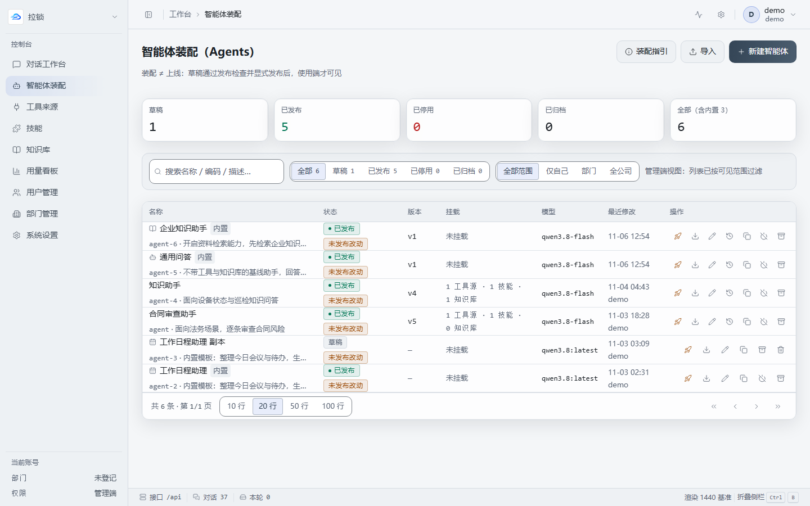
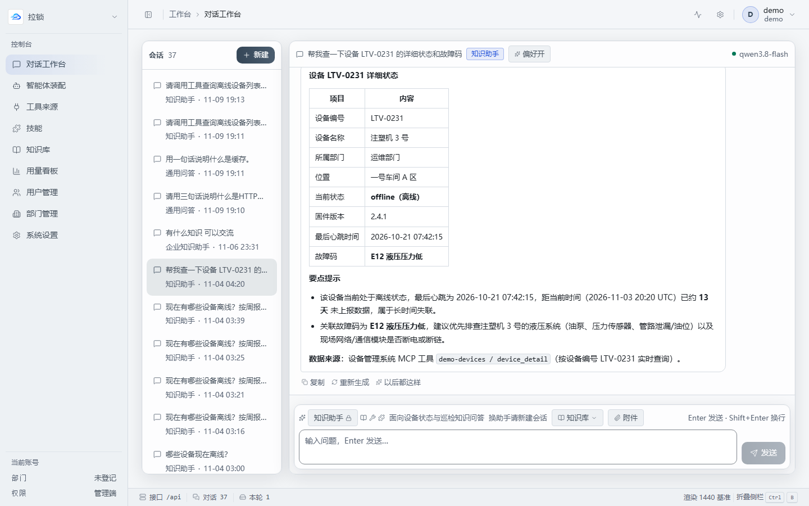
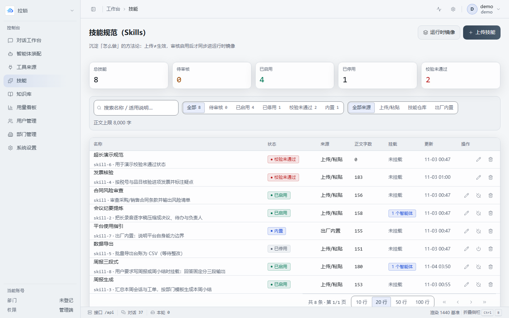
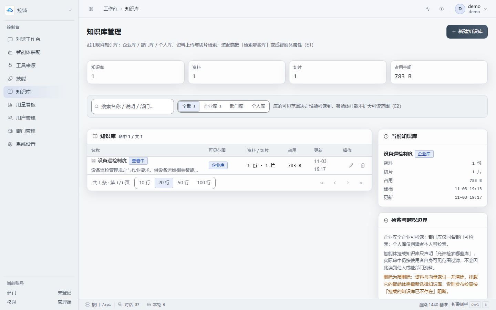
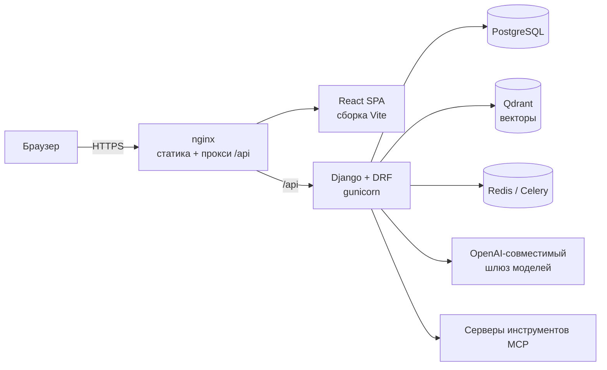

# Lasso — корпоративная платформа агентов

[English](README.md) · [简体中文](README.zh-CN.md) · [繁體中文](README.zh-TW.md) · [日本語](README.ja.md) · **Русский**

[](LICENSE)
[](frontend/package.json)
[](https://www.python.org/)
[](https://www.djangoproject.com/)
[](https://react.dev/)
[](https://vite.dev/)

**Разверните у себя платформу агентов, которую ИТ-департамент готов согласовать:** версионируемые
агенты, управляемые права на инструменты, поэтапное включение навыков и журнал аудита, отвечающий
на вопрос «кто что изменил». Docker не требуется.

Lasso — платформа управления агентами для самостоятельного размещения. Она собирает модель,
промпт, инструменты MCP, навыки и базы знаний в **версионируемый актив**, выпускает его через
проверки перед публикацией и хранит сведения о том, кому доступен агент, какая версия работает
в продакшене и чего касался каждый вызов инструмента.

> Скриншоты ниже сделаны на демонстрационном наборе данных. Язык интерфейса на изображениях —
> китайский; тексты в приложении локализуемы, изображения иллюстрируют компоновку и сценарии работы.

| Сборка агента | Рабочее пространство чата |
|---|---|
|  |  |

| Навыки | База знаний |
|---|---|
|  |  |

---

## Зачем нужен Lasso

Большинство «платформ агентов» заканчиваются окном чата и одним API-ключом. В продакшене вопросы
становятся организационными:

- **Какому подразделению показывать этого агента?** Область видимости должна сужаться, а не быть
  по умолчанию общей для всей компании.
- **Можно ли ему вызывать этот инструмент с записью?** Права выдаются на отдельный инструмент,
  а не на весь сервер инструментов.
- **Кто-то изменил конфигурацию — это уже в продакшене?** Редактирование и публикация должны быть
  разными действиями.
- **Как перенести агента в другое окружение?** Не унося с собой ключи модели и секреты MCP.
- **Кто это изменил и что именно произошло?** Журнал аудита — обязательное требование, а не бонус.

Lasso превращает ответы на эти вопросы в возможности продукта, а не в устные договорённости.

## Матрица возможностей

| Возможность | Что делает |
|---|---|
| **Версионируемые агенты** | Модель, промпт, инструменты, навыки и базы знаний собираются в одного агента. Каждая публикация создаёт неизменяемую версию с построчным сравнением полей; неопубликованные правки не попадают к пользователям. |
| **Проверки перед публикацией** | Перед запуском выполняется список блокирующих и предупреждающих проверок. Откат версии проходит те же проверки и создаёт новую версию, не переписывая историю. |
| **Управление инструментами MCP и переключатель выхода в сеть** | Регистрация источников инструментов, обнаружение инструментов и авторизация по каждому инструменту в четырёх режимах (белый список, автоодобрение, запрос при каждом вызове, только чтение). Общий переключатель выхода в сеть и белые списки доменов по источникам определяют, доступна ли агенту внешняя сеть; тела вызовов сохраняются с удалёнными секретами. |
| **Маскирование чувствительных данных с аудитом раскрытия** | Аргументы и результаты вызовов инструментов хранятся как есть, но отображаются с маскированием ключей, токенов и паролей. Раскрытие оригинала — явное действие, которое пишет в журнал аудита запись `sensitive_reveal` с автором, целевым полем и числом замаскированных полей, поэтому ситуации «посмотрел, но следа нет» не возникает. |
| **Поэтапное включение навыков и целевые пользователи** | Навыки — пакеты `SKILL.md`, проходящие проверку. Видимость складывается из области подразделения, стабильного процентного раскатывания (один и тот же пользователь всегда попадает в один и тот же бакет) и списка разрешённых пользователей; администратор всегда видит, включён навык и с каким процентом. |
| **Базы знаний и поиск** | Загрузка документов, разбиение на фрагменты, векторный поиск. Каждый агент объявляет, из каких баз он может искать, а итоговая выдача всё равно фильтруется по области видимости самого пользователя. |
| **OCR при загрузке документов** | PDF и изображения проверяются постранично: страница с реальным текстовым слоем извлекается как есть, страницы без слоя или со слишком коротким текстом уходят в OCR — сначала настроенная мультимодальная модель, затем локальный tesseract как резерв. Для каждого документа хранится `extraction_report` (текстовый слой / OCR / не распознано по каждой странице), а фрагменты несут номер страницы и признак OCR; документ, где не удалось распознать все страницы, помечается failed, а не «завершённым» с нулём фрагментов. |
| **Сетевые прокси на уровне ресурсов** | Платформенные записи HTTP / SOCKS5 с зашифрованными паролями только на запись. Прокси привязывается к ресурсу — движку SearXNG, домену обхода Тяньгун или сайту-источнику. Применение сохраняет резервную копию, записывает привязку в действующий конфиг SearXNG, перезапускает сервис, проверяет здоровье и автоматически откатывается к предыдущему конфигу при ошибке; неприменившиеся привязки помечаются в интерфейсе. |
| **Режим Нюйва (агент из одного абзаца)** | Из описания на естественном языке генерируется редактируемый каркас (имя, позиционирование, системный промпт, уровень модели, область видимости, приветствие), подбираются публичные источники инструментов MCP и навыки, а по описанию загружаются справочные материалы в базу знаний. Результат всегда черновик; каждый шаг можно прервать, продолжить и изменить. |
| **Маркетплейс инструментов и навыков** | На страницах «Инструменты» и «Навыки» по две вкладки: локальный список источников и поиск по публичному маркетплейсу. Маркетплейс даёт список, поиск, фильтры по источнику и доверию, карточку деталей и заявку на импорт на месте; старые ссылки `/market/*` перенаправляются на нужную вкладку. |
| **Режим Тяньгун (четырёхуровневый поиск)** | Каждая база знаний выполняет строго упорядоченную цепочку: **L1** подтверждённые администратором привязки поиска MCP, **L2** SearXNG (включён по умолчанию), **L3** резервный вариант с безголовым Bing (выключен по умолчанию, Playwright опционален), затем **L4** обход одобренных источников. Поисковые уровни создают только предложения-кандидаты; администратор одобряет предложение, и лишь затем сайт попадает в библиотеку источников и может быть обойдён. Обход соблюдает robots.txt, Crawl-delay, проверки публичного HTTPS и приватных сетей, лимит страниц на запуск, а каждый запуск фиксирует, какой уровень сработал и почему остальные пропущены. |
| **Изолированный worker базы знаний** | Разбор документов, OCR и сбор Тяньгун выполняются в отдельной очереди Celery `knowledge` с отдельным systemd-worker, поэтому крупная загрузка не блокирует интерактивные запросы. |
| **Сквозной аудит** | Публикация, откат, согласование импорта, изменение прав, сброс пароля администратором, события входа, решения по выходу в сеть — всё пишется в журнал аудита с указанием автора, IP и User-Agent. |
| **Потоковый чат через SSE** | Потоковые ответы по SSE, ссылки на фрагменты базы знаний, таймлайн вызовов инструментов, остановка и повторная генерация, история диалогов, вложения и учёт токенов по каждому ходу. |
| **Экспорт и импорт между окружениями** | Пакет экспорта не содержит ключей модели, секретов MCP и токенов. Импорт — запрос одного уровня, который должен одобрить **другой администратор**, и только после этого данные записываются. |
| **Дерево подразделений и две роли** | Иерархия подразделений, три области видимости (вся компания, подразделение, только администраторы) и строгое разделение обычных пользователей и администраторов. |

## Режим Нюйва и маркетплейс инструментов и навыков

Режим Нюйва превращает один абзац обычного текста в рабочий черновик агента. Публикацию он за вас не делает.

| Шаг | Что происходит | Что можно изменить |
|---|---|---|
| 1. Описание | Вы пишете, что делает агент, для кого он и что должен выдавать. | Описание, аудитория, подразделение |
| 2. Каркас | Генерируются имя, slug, позиционирование, системный промпт, уровень модели, область видимости и приветствие. | Любое поле |
| 3. Инструменты и навыки | Публичные источники инструментов MCP и навыки сопоставляются с описанием и ранжируются; у каждого кандидата видны краткое описание возможностей, необходимость выхода в сеть, наличие скриптов и лицензия. | Какие элементы подключить |
| 4. Материалы | Справочные страницы загружаются онлайн, очищаются и дедуплицируются; статус показывается по каждому URL до записи. | Какие страницы импортировать и в какую базу знаний |
| 5. Черновик | Агент создаётся в статусе **черновик** с выбранными подключениями и базой знаний. | Всё в разделе сборки агентов |

**Один пункт меню — две вкладки.** «Инструменты» (`/mcp`) и «Навыки» (`/skills`) содержат по две
вкладки: локальный список и публичный маркетплейс. Маркетплейс даёт список, поиск, фильтры по источнику и
доверию, карточку деталей и заявку на импорт на месте; старые `/market/mcp` и `/market/skills`
перенаправляются на нужную вкладку. Обе вкладки используют тот же сервис поиска и ту же заявку, что и шаг 3
мастера, поэтому логика и правила согласования существуют в одном экземпляре.

**Сначала онлайн, затем локальный резерв.** `nuwa_market_online` включён по умолчанию: поиск идёт
напрямую в публичный registry и репозиторий навыков, а найденные элементы одновременно пишутся в
локальный каталог. При сбое сети, тайм-ауте, блокировке или выключенном администратором переключателе
страницы переходят на локальную копию и помечают это: `mode` равен `online`, `mixed` или `cached`, а
`degraded_reason` объясняет причину (`switch_off`, `timeout`, `network_error`, `rate_limited`,
`http_error`, `offline_no_cache`) вместе с датой последней синхронизации. Ошибок и пустых экранов нет.

**Два независимых семейства переключателей.** Выход в сеть для Нюйва (`nuwa_market_online`,
`nuwa_knowledge_online`) относится только к поиску в маркетплейсе и загрузке материалов. Выход в сеть
для инструментов работающих агентов (`mcp_egress_enabled`) — отдельный переключатель: отключение
одного не влияет на другой. Администраторы читают и меняют переключатели Нюйва через
`GET|POST /api/nuwa/switches/`.

**Правила согласования не изменились.** Всё, что получено из публичного маркетплейса, — внешний контент.
Заявка на импорт одноуровневая, и подавший не может одобрить собственную заявку. Одобренный источник
MCP сохраняется как `unknown` и **со всеми отключёнными инструментами**; одобренный навык сохраняется
как `pending` и не попадает в среду выполнения до проверки. Результат Нюйва всегда черновик — публикация
проходит обычную проверку перед публикацией.

```bash
# Обновить локальный каталог из публичного маркетплейса (онлайн)
python manage.py nuwa_sync

# Выгрузить каталог там, где есть интернет, и импортировать его во внутренней сети
python manage.py nuwa_sync --export data/nuwa/market-cache.json
python manage.py nuwa_sync --import data/nuwa/market-cache.json
```

## Режим Тяньгун: четырёхуровневый поиск знаний

Тяньгун («天工开物») — сборщик на уровне базы знаний. Включите «Получать связанные знания» при создании
базы, и платформа сама соберёт материал. Переключатели можно изменить позже; они влияют только на
последующие запуски.

**Четыре уровня, одна цепочка.** Каждый запуск идёт строго по порядку и останавливается на первом уровне,
который дал достаточно пригодных результатов.

| Уровень | Что делает | По умолчанию |
|---|---|---|
| **L1 — поиск MCP** | Вызывает поисковые инструменты, которые администратор явно привязал из зарегистрированных серверов MCP: сопоставление query / limit / полей результата, приоритет, отдельный тест привязки. Ни один вендор не зашит, инструменты не включаются автоматически. | Включён после подтверждения привязки |
| **L2 — SearXNG** | Запрашивает локальный JSON-эндпоинт SearXNG с таймаутами, ограничением частоты и предохранителем. | Включён |
| **L3 — резерв Bing** | Безголовый Chromium под управлением Playwright запрашивает только Bing. Другие движки не разбираются, CAPTCHA и риск-контроль не обходятся: CAPTCHA или HTTP 429 фиксируются как ошибка и открывают предохранитель на 24 часа. Браузер — необязательная предпосылка развёртывания, уровень выключен по умолчанию и пропускается с понятной причиной, если недоступен. | Выключен |
| **L4 — библиотека источников** | Обходит одобренные источники и временные seed-URL базы знаний: соблюдает robots.txt и Crawl-delay, идёт по одному хосту последовательно, отсекает дубликаты по URL и отпечатку содержимого, ограничивает число страниц на запуск. | Включён |

**Поиск создаёт предложения, а не документы.** L1–L3 пишут только строки `TiangongSourceProposal`
(`discovered_by` = `mcp` / `searxng` / `bing`). Администратор одобряет или отклоняет каждое предложение;
одобрение создаёт или объединяет `TiangongSource`. На L4 обходятся только включённые источники, поэтому
неодобренный URL никогда не попадает в базу знаний. Каждый запуск сохраняет `TiangongRun` с цепочкой
деградации (уровень, результат, причина, число, время) и одну агрегированную запись аудита — без строк
на каждый URL.

**Защита от приватных сетей.** URL-кандидаты должны быть публичными HTTPS. DNS разрешается только по
IPv4; приватные, loopback, link-local и интрасетевые хосты отклоняются, та же проверка повторяется при
реальном подключении. Прокси, если настроены, привязываются к ресурсу — движку SearXNG, домену обхода
Тяньгун или сайту-источнику — с зашифрованными паролями, которые не возвращаются в API и не пишутся в
аудит.

**Ограниченно и объяснимо.** Один запуск добавляет не более 5 веб-страниц и 1 обзора модели; дальнейшие
запуски — вручную. Обзор модели несёт `source_type='model'` и имя модели и не выдаётся за первоисточник.
Нет сети → только модель; модель не настроена → только веб; переключатель выключен → запуск пропускается с
причиной; оба недоступны → запуск помечается failed с понятным сообщением. База остаётся рабочей, ответы
не возвращают 500.

**Права и независимые переключатели.** Включать и запускать может только владелец или администратор.
`tiangong_enabled`, `tiangong_online` и переключатели поисковых уровней управляют только Тяньгун и не
читают `nuwa_market_online` / `nuwa_knowledge_online`; выход в сеть для инструментов
(`mcp_egress_enabled`) тоже отдельный. Общий только список разрешённых доменов как граница безопасности.
Администраторы управляют общими переключателями через `GET|POST /api/knowledge/tiangong/switches/`, а
поисковыми уровнями — через `GET|POST /api/knowledge/tiangong-search/settings/`.

## Архитектура



| Слой | Технологии |
|---|---|
| Фронтенд | React 19.2, TypeScript 6, Vite 8.3, Tailwind CSS 4.3, TanStack Query 5, Zustand 5 |
| Бэкенд | Django 5.2 (5.2.17), Django REST Framework 3.18, SimpleJWT, gunicorn 23 |
| Данные | PostgreSQL 14+ (SQLite для локальной разработки), Qdrant 1.19 (опционально), Redis / Celery (опционально) |
| Интеграции | Любой шлюз, совместимый с OpenAI Chat Completions, серверы инструментов MCP |

В `backend/apps/` одиннадцать модулей Django: `agenthub`, `agents`, `chat`, `skills`, `knowledge`,
`mcp`, `nuwa`, `users`, `settings`, `usage` и общие помощники `common` — на них лежит доменная логика.

## Быстрый старт (5 минут)

**Требования:** Python 3.11+, Node.js 20+, база данных — SQLite (по умолчанию) или PostgreSQL 14+.
Для старта не нужны Docker, брокер сообщений и векторная база данных.

### 1. Установка бэкенда

```bash
python -m venv .venv
source .venv/bin/activate          # Windows: .venv\Scripts\activate
pip install -r requirements.txt
```

### 2. Инициализация базы данных

```bash
cp .env.example .env               # затем заполните значения
python manage.py migrate
python manage.py createsuperuser
python manage.py init_builtin_agents   # опционально: встроенные агенты
```

### 3. Запуск API

```bash
python manage.py runserver 127.0.0.1:8000
```

### 4. Запуск консоли

```bash
cd frontend
npm ci
npm run dev                        # http://localhost:5173, /api проксируется на :8000
```

Откройте <http://localhost:5173> и войдите под созданным администратором.

### 5. Соберите первого агента

1. Откройте **Сборку агентов** и нажмите **Новый агент**.
2. Выберите модель (сначала настройте и проверьте шлюз в **Настройках системы**), напишите промпт,
   подключите нужные инструменты, навыки и базы знаний.
3. Запустите проверку перед публикацией, опубликуйте и убедитесь, что в списке версий появилась
   новая неизменяемая версия.
4. Откройте **Рабочее пространство чата**, выберите агента и отправьте первое сообщение: ответ,
   источники цитирования и таймлайн вызовов инструментов сохранятся в диалоге.

Сборка для продакшена: `cd frontend && npm run build`, затем отдайте `frontend/dist` через nginx.

### 6. Попробуйте режим Нюйва и объединённый маркетплейс

1. В боковом меню ровно два пункта каталога: **Инструменты** и **Навыки**. На каждой странице две вкладки —
   локальный список и публичный маркетплейс; старые `/market/mcp` и `/market/skills` перенаправляются на
   нужную вкладку.
2. В разделе **Сборка агентов** выберите **Режим Нюйва**, опишите агента одним абзацем и пройдите пять
   шагов: каркас → инструменты и навыки → материалы → черновик.
3. Выбранные во внешнем маркетплейсе элементы остаются **в ожидании согласования** другого администратора:
   источники MCP сохраняются как `unknown` с отключёнными инструментами, навыки — как `pending`.
4. На хосте без интернета выгрузите каталог там, где доступ в сеть есть, и импортируйте его во внутренней
   сети; вкладки маркетплейса продолжат работать с локальной копией и покажут причину деградации.

```bash
python manage.py nuwa_sync                                        # онлайн-обновление
python manage.py nuwa_sync --export data/nuwa/market-cache.json   # на хосте с интернетом
python manage.py nuwa_sync --import data/nuwa/market-cache.json   # во внутренней сети
```

### 7. Попробуйте режим Тяньгун

1. В разделе **Базы знаний** нажмите **Новая база знаний** и включите **Получать связанные знания**.
2. Заполните **Темы сбора** (необязательно; по умолчанию имя и описание) и **Точки входа** (необязательно,
   до 5 URL), сохраните. Первый сбор запустится автоматически.
3. На странице Тяньгун проверьте три вкладки: **Библиотека источников** (одобренные источники),
   **Кандидаты** (предложения на согласовании) и **Поиск и сбор** (переключатели и параметры уровней).
   L2 SearXNG включён по умолчанию; L1 требует подтверждённой привязки поиска MCP; L3 Bing выключен, пока
   на хосте не установлен необязательный браузер Playwright.
4. Одобрьте источники, которым доверяете. Следующий запуск обойдёт только одобренные источники и
   импортирует текст; каждый документ будет помечен «Внешняя страница» или «Сгенерировано моделью».
5. Если поисковый уровень дал сбой, в записи запуска останутся уровень и причина, а обход библиотеки
   источников продолжится. Переключатели Тяньгун не зависят от переключателей выхода в сеть Нюйва.


## Конфигурация

Вся конфигурация времени выполнения берётся из переменных окружения или локального `.env`.
Скопируйте [`.env.example`](.env.example) и заполните своими значениями: файл содержит только
заглушки, описывает каждую переменную и намеренно не содержит реальных хостов, ключей и аккаунтов.

| Группа | Переменные | Примечания |
|---|---|---|
| Базовые | `SECRET_KEY`, `DEBUG`, `ALLOWED_HOSTS`, `ALLOW_REGISTER` | `SECRET_KEY` должен быть уникальным для каждого окружения |
| Аутентификация | `JWT_SIGNING_KEY`, `JWT_*_LIFETIME_*`, `LOGIN_FAILURE_*`, `AUTH_TRUSTED_PROXIES` | Ротация ключа подписи аннулирует выданные токены |
| База данных | `DB_ENGINE`, `DB_NAME`, `DB_USER`, `DB_PASSWORD`, `DB_HOST`, `DB_PORT` | По умолчанию `sqlite3`; для общего окружения рекомендуется PostgreSQL |
| Шифрование при хранении | `MCP_SECRET_KEY` | Шифрует сохранённые учётные данные MCP; в экспорт не попадает |
| Поиск | `VECTOR_STORE`, `QDRANT_*`, `FASTEMBED_*` | Для локальной разработки Qdrant не обязателен |
| Асинхронность | `CELERY_BROKER_URL`, `CELERY_RESULT_BACKEND`, `CELERY_TASK_*` | Режим eager работает без брокера |
| Модель | `LLM_BASE_URL`, `LLM_API_KEY`, `LLM_MODEL`, `LLM_*` | Любой OpenAI-совместимый шлюз; можно задать и в админке |

## Сравнение с типовыми подходами

Сравнение качественное и ограничено возможностями, на которые ориентирован проект. Первые два
столбца описывают **типичные формы** таких подходов, а не конкретные продукты.

| Критерий | Типичный чат-ориентированный фреймворк | Типичная SaaS-платформа агентов | Lasso |
|---|---|---|---|
| Версии агентов с проверками перед публикацией | — | Частично | Да |
| Авторизация по инструментам и переключатель выхода в сеть | — | Частично | Да |
| Процент раскатывания навыков и список пользователей | — | — | Да |
| Область видимости по подразделениям внутри продукта | — | Частично | Да |
| Импорт с одобрением второго администратора | — | — | Да |
| Журнал аудита публикаций, прав и выхода в сеть | Частично | Частично | Да |
| Развёртывание на своём хосте без Docker | Да | Нет | Да |
| Заменяемый шлюз моделей | Да | Частично | Да |

## Форма развёртывания

Эталонное развёртывание — на «голом железе»: **nginx** отдаёт статику и проксирует `/api`,
**gunicorn** работает под **systemd**, база данных — **PostgreSQL 14+**, Redis / Celery и Qdrant
включаются по необходимости. **Docker не требуется и не используется.**

- `deploy/nginx/` — блоки server для API и медиа, а также эталонный `nginx.conf`.
- `deploy/systemd/lasso.service` — unit для gunicorn с политикой перезапуска и логами в journald.
- `deploy/systemd/lasso-knowledge-worker.service` — отдельный worker очереди `knowledge` (разбор, OCR, сбор Тяньгун).
- `deploy/searxng/` — эталон установки и настройки SearXNG для L2.
- `deploy/ops/install_ocr.sh` — необязательный локальный резерв tesseract для OCR.
- `deploy/install_playwright.sh` — необязательная предпосылка Playwright + Chromium для резерва L3 Bing.
- [docs/DEPLOYMENT.md](docs/DEPLOYMENT.md) — пошаговая настройка, миграция и разбор проблем.

## Структура проекта

```
agent-platform/
├── backend/                 проект Django
│   ├── apps/agenthub/       агенты, версии, публикация, заявки на импорт
│   ├── apps/agents/         среда выполнения, реестр инструментов, мост
│   ├── apps/chat/           диалоги, потоковая выдача, вызовы инструментов
│   ├── apps/skills/         пакеты навыков, раскатывание, подключение
│   ├── apps/knowledge/      базы знаний, документы, поиск, обнаружение Тяньгун, OCR
│   ├── apps/mcp/            источники инструментов, обнаружение, учётные данные, демо-сервер
│   ├── apps/users/          аккаунты, подразделения, журнал аудита
│   ├── apps/settings/       настройки платформы и проверка подключения к модели
│   ├── apps/usage/          расход токенов и аналитика
│   ├── apps/nuwa/          режим Нюйва: каталог рынка, сессии мастера, заявки на импорт
│   └── apps/common/         общие помощники для модели, эмбеддингов и медиа
├── frontend/                одностраничное приложение React + Vite
│   └── src/pages/           агенты (включая Нюйва), чат, инструменты (с маркетплейсом), навыки (с маркетплейсом), знания, пользователи, настройки
├── deploy/                  nginx, systemd, SearXNG и вспомогательные скрипты OCR / Playwright
├── docs/                    справочник API, матрица прав, руководство по развёртыванию, скриншоты
├── .env.example             шаблон конфигурации
└── requirements.txt
```

## Указатель документации

| Документ | Содержание |
|---|---|
| [docs/DEPLOYMENT.md](docs/DEPLOYMENT.md) | Промышленное развёртывание, настройка и устранение неполадок |
| [docs/api-reference.md](docs/api-reference.md) | Справочник эндпоинтов REST API |
| [docs/auth-permission-matrix.md](docs/auth-permission-matrix.md) | Аутентификация, роли и права на уровне объектов |
| [docs/assets/screenshots/README.md](docs/assets/screenshots/README.md) | Правила съёмки и маскирования скриншотов |
| [CONTRIBUTING.md](CONTRIBUTING.md) | Как предлагать изменения и открывать pull request |
| [SECURITY.md](SECURITY.md) | Закрытый канал сообщений об уязвимостях и чек-лист усиления |
| [CODE_OF_CONDUCT.md](CODE_OF_CONDUCT.md) | Правила сообщества и порядок их применения |
| [docs/design/nuwa-mode.md](docs/design/nuwa-mode.md) | Проектирование режима Нюйва и маркетплейса: переключатели, деградация, согласование (на китайском) |
| [.env.example](.env.example) | Все поддерживаемые переменные окружения, только заглушки |

## Участие в проекте

Мы рады вкладу сообщества — см. [CONTRIBUTING.md](CONTRIBUTING.md) и
[Кодекс поведения](CODE_OF_CONDUCT.md). Об уязвимостях сообщайте закрыто, как описано в
[SECURITY.md](SECURITY.md), и не открывайте публичный issue.

## Лицензия

Проект распространяется по **Apache License 2.0** — полный текст в [LICENSE](LICENSE).

- Разрешены коммерческое использование, изменение, распространение и приватное использование.
- Необходимо сохранять уведомление об авторских правах, текст лицензии и файл `NOTICE`, а также
  указывать внесённые изменения в изменённых файлах.
- Программное обеспечение предоставляется **без каких-либо гарантий**, авторы не несут
  ответственности за ущерб.
- Apache-2.0 также предоставляет явную патентную лицензию и требует не использовать товарные знаки
  проекта для продвижения производных продуктов.

Copyright 2026 Lasso contributors.