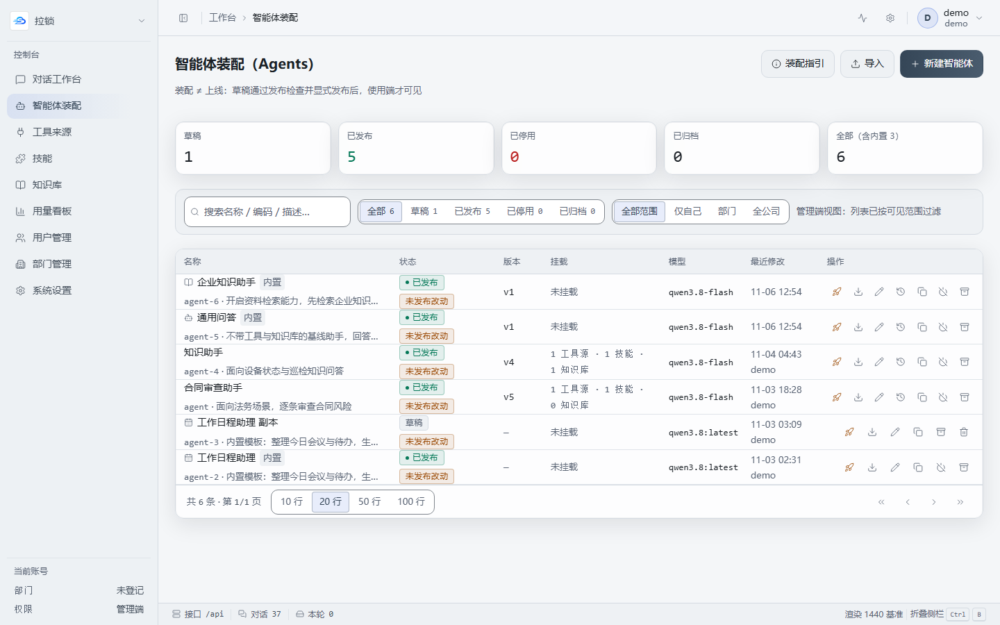
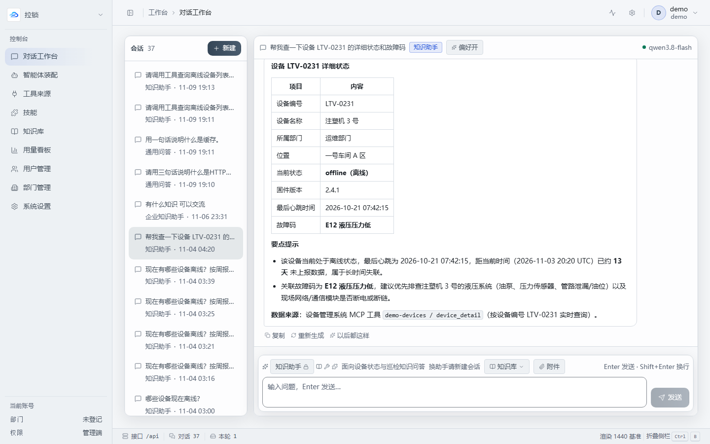
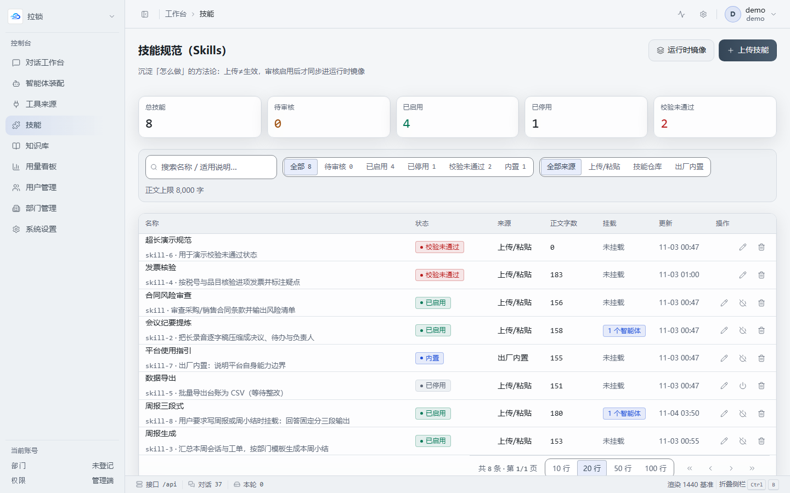
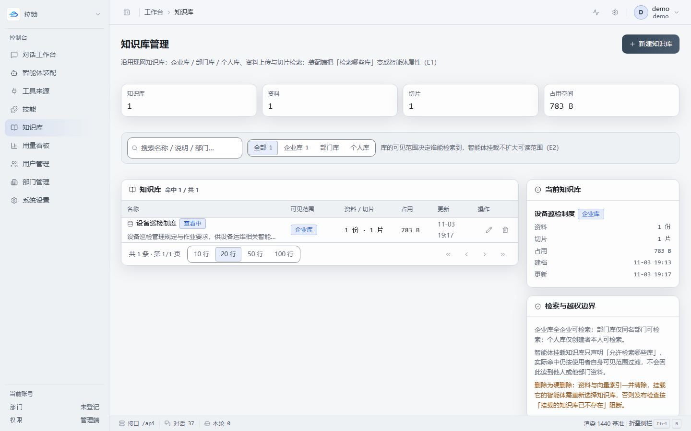
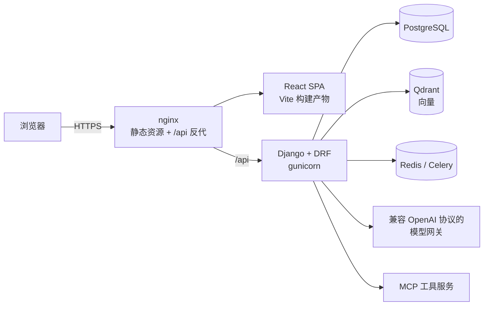

# Lasso — 企业级智能体平台

[English](README.md) · **简体中文** · [繁體中文](README.zh-TW.md) · [日本語](README.ja.md) · [Русский](README.ru.md)

[](LICENSE)
[](frontend/package.json)
[](https://www.python.org/)
[](https://www.djangoproject.com/)
[](https://react.dev/)
[](https://vite.dev/)

**私有化部署一套IT部门敢签字放行的智能体平台：**智能体版本化、工具授权可治理、技能灰度可控、
审计日志答得上"谁改了什么"，而且不需要 Docker。

Lasso 是面向企业的自托管智能体管控平台。它把模型、提示词、MCP 工具、技能与知识库装配成一个
**可版本化的资产**，经发布检查后上线，并持续记录谁能用、线上跑的是哪一版、每次工具调用碰了什么。

> 以下截图取自演示数据集。截图里的界面语言是中文；界面文案在应用内可本地化，图片用于说明
> 布局与操作流程。

| 智能体装配 | 对话工作台 |
|---|---|
|  |  |

| 技能 | 知识库 |
|---|---|
|  |  |

---

## 为什么做 Lasso

大多数"智能体平台"止步于一个对话框加一个 API Key。真正上生产后，问题会变成组织问题：

- **这个智能体该给哪个部门看？** 可见范围必须能收窄，而不是默认全公司可见。
- **它能调这个写操作工具吗？** 授权要按工具逐个给，而不是按整个工具服务放行。
- **有人改了配置，线上是不是已经生效？** 编辑与发布必须是两个动作。
- **怎么搬到下一套环境？** 而且不能把模型 Key 和 MCP 密钥一起打包带走。
- **谁改的，它到底做了什么？** 审计日志是硬要求，不是加分项。

Lasso 把这些问题的答案做成了产品能力，而不是靠口头约定。

## 核心能力矩阵

| 能力 | 具体行为 |
|---|---|
| **版本化智能体** | 模型、提示词、工具、技能与知识库装配成一个智能体；每次发布生成不可变版本，并给出字段级差异；未发布的修改不会到达使用者。 |
| **发布前检查** | 上线前跑阻断项与告警项清单；版本回滚同样重走这份清单，并生成新版本，而不是覆盖历史。 |
| **MCP 工具治理与出网开关** | 登记工具来源、发现工具，再按工具逐个授权，四档（白名单 / 自动放行 / 逐次询问 / 只读）。平台级出网总开关配合按来源的域名白名单决定智能体能否访问外网；工具调用正文入库前脱敏。 |
| **敏感内容掩码与展开留痕** | 工具调用参数与结果按原文入库，展示层对密钥、令牌、口令等敏感值打码；展开原文是显式动作，会写入一条 `sensitive_reveal` 审计（操作人、目标字段、掩码字段数），不会出现"看了却查不到"。 |
| **技能灰度与定向用户** | 技能以 `SKILL.md` 包管理并需要审核。可见范围由部门范围、稳定百分比灰度（同一用户恒定命中同一桶）与定向用户白名单叠加；管理员始终能看到技能是否启用、灰度比例是多少。 |
| **知识库与检索** | 文档入库、切片、向量检索；每个智能体声明可检索哪些知识库，实际命中结果仍按使用者自身可见范围过滤。 |
| **OCR 文档入库** | PDF 与图片逐页判定：有真实文字层的页面直接提取，缺文字层或过短的页面走 OCR——优先使用已配置的多模态模型，本机 tesseract 兜底。每份文档保留 `extraction_report`（逐页标注文字层 / OCR / 未解析）与切片级页码、OCR 标记；全部页面都失败时文档标记为失败，不会出现零切片的"已完成"。 |
| **按资源绑定网络代理** | 平台级 HTTP / SOCKS5 代理条目，密码加密且只写不读。代理按资源绑定——SearXNG 引擎、天工抓取域名或来源站。应用绑定会备份并写入线上 SearXNG 配置、重启并做健康检查；新配置失败时自动回滚到上一份，未生效的绑定在界面上明确标注。 |
| **女娲模式（一句话建智能体）** | 一段自然语言需求生成可编辑骨架（名称、定位、系统提示词、模型档位、可见范围、欢迎语），同时匹配公开 MCP 工具来源与技能，并按描述抓取参考资料写入知识库。产物固定为草稿；每一步都可中断、恢复、修改。 |
| **工具与技能市场** | 「工具」「技能」两个菜单各含两个选项卡：本地来源列表与公开市场检索。市场支持列表、搜索、按来源与可信度筛选、详情卡片与就地提交导入申请；旧 `/market/*` 链接自动跳到对应选项卡。 |
| **天工模式（四层检索）** | 每个知识库按严格顺序跑一条发现链：**L1** 管理员确认的 MCP 搜索绑定、**L2** SearXNG（默认开启）、**L3** Bing 无头浏览器兜底（默认关闭，可选 Playwright）、**L4** 来源库抓取。搜索层只生成候选提案，管理员批准后站点才进入来源库并允许抓正文；抓取遵守 robots.txt、Crawl-delay、公网 HTTPS 与私网防护、单轮页数上限，每轮如实记录命中层与其余层被跳过的原因。 |
| **独立的知识库 worker** | 文档解析、OCR 与天工采集走独立的 `knowledge` Celery 队列与独立 systemd worker，大文档入库不会拖垮交互请求。 |
| **全链路审计** | 发布、回滚、导入审批、权限变更、管理员重置口令、登录事件、出网判定等动作，全部写入审计日志，记录操作人、IP 与 User-Agent。 |
| **SSE 流式对话** | 通过 SSE 流式输出回答，引用回到知识切片，展示工具调用时间线，支持停止与重新生成、历史会话、附件与按轮的 token 统计。 |
| **跨环境导出导入** | 导出包不含模型 Key、MCP 密钥与令牌；导入是单级审批请求，必须由**另一名管理员**审批通过后才落库。 |
| **部门树与两级角色** | 部门层级、三种可见范围（全公司 / 指定部门 / 仅管理端），以及严格区分的普通用户与管理员。 |

## 女娲模式与工具/技能市场

女娲模式把一段自然语言变成可用的智能体草稿，它不会替你发布。

| 步骤 | 系统做什么 | 可编辑 |
|---|---|---|
| 1. 描述 | 你写清楚智能体做什么、给谁用、要输出什么。 | 需求描述、使用对象、面向部门 |
| 2. 骨架 | 生成名称、slug、定位、系统提示词、模型档位、可见范围与欢迎语。 | 每一个字段 |
| 3. 工具与技能 | 按描述匹配并排序公开 MCP 工具来源与技能；每个候选都标出能力摘要、是否需要出网、是否含脚本与许可证。 | 勾选要挂载的条目 |
| 4. 资料 | 在线抓取参考资料，清洗、去重后逐条显示抓取状态，确认后才写入。 | 勾选入库的页面、目标知识库 |
| 5. 草稿 | 以**草稿**状态创建智能体，带上已选挂载与知识库。 | 装配页里的全部内容 |

**一个菜单两个选项卡。**「工具」（`/mcp`）与「技能」（`/skills`）各含两个选项卡——本地来源列表
与公开市场。市场支持列表、搜索、按来源与可信度筛选、详情卡片与就地提交导入申请；旧 `/market/mcp`、
`/market/skills` 会跳到对应选项卡。两个选项卡与向导第三步使用同一套检索服务与同一条导入申请，只有
一套逻辑、一条审批口径。

**在线优先，本地兜底。** `nuwa_market_online` 默认开启：检索直连公开 registry 与技能仓库，命中的
条目同时写入本地目录。网络失败、超时、被墙或管理员关闭开关时，页面回落到本地副本并标注来源：
`mode` 为 `online` / `mixed` / `cached`，`degraded_reason` 说明原因（`switch_off`、`timeout`、
`network_error`、`rate_limited`、`http_error`、`offline_no_cache`），同时显示缓存同步日期；不报错、
不空白。

**两组互不影响的开关。** 女娲出网（`nuwa_market_online`、`nuwa_knowledge_online`）只服务市场检索与
资料抓取；智能体运行时的工具出网是另一个开关（`mcp_egress_enabled`）。关掉其中一个不会影响另一个。
管理员可通过 `GET|POST /api/nuwa/switches/` 查看与切换女娲开关。

**审批口径不变。** 公开市场抓到的一律是外部内容：导入是单级申请，提交人不能审批自己的申请；审批
通过的 MCP 来源落库为 `unknown` 且**工具全关**；技能落库为 `pending`，审核通过前不进运行时。女娲
产物固定为草稿，发布仍走正常的发布前检查。

```bash
# 在线刷新本地市场目录
python manage.py nuwa_sync

# 在有外网的机器导出目录包，再在内网导入（全程不出网）
python manage.py nuwa_sync --export data/nuwa/market-cache.json
python manage.py nuwa_sync --import data/nuwa/market-cache.json
```

## 天工模式：四层知识发现

天工（取「天工开物」之意）是知识库级的采集器。建库时勾选「获取相关知识」，平台就会自己找资料；
开关建库后仍可修改，且只影响之后的采集。

**四层一条链。** 每轮按严格顺序执行，命中足够可用的结果即停止：

| 层 | 做什么 | 默认 |
|---|---|---|
| **L1 MCP 搜索** | 调用管理员从已登记 MCP 服务器中显式确认的搜索工具，可配置 query / limit / 结果字段映射、优先级，并支持单条测试；不硬编码任何厂商，也不会自动启用工具。 | 确认绑定后才生效 |
| **L2 SearXNG** | 查询本机 SearXNG JSON 接口，带超时、限速与熔断。 | 开启 |
| **L3 Bing 兜底** | 由 Playwright 驱动的无头 Chromium 只查 Bing；不解析其他引擎，也不绕过验证码或风控——遇到验证码或 HTTP 429 即记为失败并当日熔断 24 小时。浏览器是可选部署前置，本层默认关闭，缺依赖时跳过并给出可读原因。 | 关闭 |
| **L4 来源库** | 抓取已批准来源与知识库临时采集入口，遵守 robots.txt 与 Crawl-delay，同一主机串行、单轮页数有上限，并按 URL 与正文指纹去重。 | 开启 |

**搜索只产候选，不产文档。** L1–L3 只写 `TiangongSourceProposal`（`discovered_by` 为 `mcp` /
`searxng` / `bing`）。管理员逐条批准或拒绝；批准时创建或合并 `TiangongSource`，只有启用的来源才会在
L4 被抓取，未批准的 URL 不会被抓进知识库。每轮落一条 `TiangongRun`，记录降级链（层、结果、原因、
条数、耗时）与一条聚合审计，不按 URL 逐条记。

**私网防护。** 候选地址必须是公网 HTTPS；DNS 只用 IPv4 解析，私网、环回、链路本地与内网主机一律
拒绝，真实连接时再校验一次。配置代理时按资源绑定——SearXNG 引擎、天工抓取域名或来源站——密码加密，
读接口不回显、审计不落明文。

**有上限、可解释。** 单轮最多 5 篇网页 + 1 篇模型整理稿，之后手动「补充采集」。模型整理稿带
`source_type='model'` 与生成模型名，不冒充原始出处。无外网 → 只走模型侧；模型未配置 → 只走网页侧；
开关关闭 → 跳过并写明原因；都不可用 → 记为失败并给出可读原因。知识库照常可用，接口不返回 500。

**权限与独立开关。** 只有库属主或平台管理员能开关与触发。`tiangong_enabled`、`tiangong_online` 与
各搜索层开关只管天工，不读取 `nuwa_market_online` / `nuwa_knowledge_online`，与工具出网
`mcp_egress_enabled` 也互不影响；只有域名白名单作为安全边界共享。管理员通过
`GET|POST /api/knowledge/tiangong/switches/` 管理总开关，通过
`GET|POST /api/knowledge/tiangong-search/settings/` 管理搜索层。

## 架构



| 层 | 技术选型 |
|---|---|
| 前端 | React 19.2、TypeScript 6、Vite 8.3、Tailwind CSS 4.3、TanStack Query 5、Zustand 5 |
| 后端 | Django 5.2（5.2.17）、Django REST Framework 3.18、SimpleJWT、gunicorn 23 |
| 数据 | PostgreSQL 14+（本地开发可用 SQLite）、Qdrant 1.19（可选）、Redis / Celery（可选） |
| 集成 | 任意兼容 OpenAI Chat Completions 的网关、MCP 工具服务 |

`backend/apps/` 下共 11 个 Django 模块承载领域逻辑：`agenthub`、`agents`、`chat`、`skills`、
`knowledge`、`mcp`、`nuwa`、`users`、`settings`、`usage`，以及共享工具 `common`。

## 快速开始（5 分钟）

**环境要求：** Python 3.11+、Node.js 20+，数据库用默认 SQLite 或 PostgreSQL 14+ 都可以。
起步阶段不需要 Docker、不需要消息队列，也不需要向量数据库。

### 1. 安装后端

```bash
python -m venv .venv
source .venv/bin/activate          # Windows: .venv\Scripts\activate
pip install -r requirements.txt
```

### 2. 初始化数据库

```bash
cp .env.example .env               # 然后按实际环境填写
python manage.py migrate
python manage.py createsuperuser
python manage.py init_builtin_agents   # 可选：初始化内置智能体
```

### 3. 启动 API

```bash
python manage.py runserver 127.0.0.1:8000
```

### 4. 启动控制台

```bash
cd frontend
npm ci
npm run dev                        # http://localhost:5173，/api 代理到 :8000
```

打开 <http://localhost:5173>，用刚创建的管理员账号登录。

### 5. 装配第一个智能体

1. 进入**智能体装配**，点**新建智能体**。
2. 选择模型（先在**系统设置**里配置并验证网关），填写提示词，挂载需要的工具、技能与知识库。
3. 跑一遍发布前检查，发布，确认新版本（不可变）出现在版本列表里。
4. 进入**对话工作台**，选择该智能体发出第一条消息；回答、引用来源与工具调用时间线都会留在会话里。

生产构建：执行 `cd frontend && npm run build`，把 `frontend/dist` 交给 nginx 托管。

### 6. 试试女娲模式与合并后的市场

1. 侧栏只有两个目录入口：**工具**与**技能**。每个页面两个选项卡——本地列表与公开市场；旧
   `/market/mcp`、`/market/skills` 会跳到对应选项卡。
2. 在**智能体装配**页选择**女娲模式**，用一段话描述需求，按五步走完：骨架 → 工具与技能 → 参考资料 → 草稿。
3. 从公开市场勾选的条目会先落**待审批**，需另一名管理员审批：MCP 来源落库为 `unknown` 且工具全关，
   技能落库为 `pending`。
4. 内网机器没有外网时，在有外网的环境导出目录包，再在内网导入；市场选项卡会继续用本地副本工作，
   并标注降级原因。

```bash
python manage.py nuwa_sync                                        # 在线刷新
python manage.py nuwa_sync --export data/nuwa/market-cache.json   # 有外网的机器
python manage.py nuwa_sync --import data/nuwa/market-cache.json   # 内网导入
```

### 7. 试试天工模式

1. 在**知识库**点**新建知识库**，打开**获取相关知识**（天工模式）。
2. 填**采集主题**（可选，默认用名称与说明）与**采集入口**（可选，最多 5 个 URL），保存后自动跑首轮。
3. 进入天工页面的三个选项卡：**来源库**（已批准来源）、**候选来源**（待审批提案）与**搜索与抓取**
   （各层开关与参数）。L2 SearXNG 默认开启；L1 需要先确认 MCP 搜索绑定；L3 Bing 默认关闭，需先在
   服务器安装可选的 Playwright 浏览器。
4. 批准你信任的候选；下一轮只抓已批准来源并导入正文，每条资料标「外部网页」或「模型生成」。
5. 某一搜索层失败时，采集记录会写明该层与原因，并继续抓取来源库；天工开关与女娲出网开关互不影响。


## 配置

运行期配置全部来自环境变量或本地 `.env`。复制 [`.env.example`](.env.example) 后填写自己的值：
该文件只包含占位值，逐项说明了每个变量的含义，且有意不包含任何真实主机、密钥或账号。

| 分组 | 变量 | 说明 |
|---|---|---|
| 基础 | `SECRET_KEY`、`DEBUG`、`ALLOWED_HOSTS`、`ALLOW_REGISTER` | `SECRET_KEY` 每套环境必须不同 |
| 认证 | `JWT_SIGNING_KEY`、`JWT_*_LIFETIME_*`、`LOGIN_FAILURE_*`、`AUTH_TRUSTED_PROXIES` | 轮换签名密钥会使已签发令牌失效 |
| 数据库 | `DB_ENGINE`、`DB_NAME`、`DB_USER`、`DB_PASSWORD`、`DB_HOST`、`DB_PORT` | 默认 `sqlite3`，共享环境建议 PostgreSQL |
| 静态加密 | `MCP_SECRET_KEY` | 加密存储的 MCP 凭据，永不随导出包外带 |
| 检索 | `VECTOR_STORE`、`QDRANT_*`、`FASTEMBED_*` | 本地开发可不启 Qdrant |
| 异步 | `CELERY_BROKER_URL`、`CELERY_RESULT_BACKEND`、`CELERY_TASK_*` | 没有 broker 时可用 eager 模式 |
| 模型 | `LLM_BASE_URL`、`LLM_API_KEY`、`LLM_MODEL`、`LLM_*` | 兼容 OpenAI 协议；也可在管理端配置 |

## 与常见方案的对比

对比只做定性判断，聚焦本项目关注的能力维度；前两列描述的是这两类方案的**典型形态**，
不针对任何具体产品。

| 维度 | 典型对话型智能体框架 | 典型 SaaS 智能体平台 | Lasso |
|---|---|---|---|
| 带发布检查的智能体版本 | — | 部分 | 支持 |
| 按工具授权与平台出网开关 | — | 部分 | 支持 |
| 技能灰度比例与定向用户白名单 | — | — | 支持 |
| 产品内的部门级可见范围 | — | 部分 | 支持 |
| 需另一名管理员审批的导入 | — | — | 支持 |
| 覆盖发布、权限与出网的审计日志 | 部分 | 部分 | 支持 |
| 自有主机部署且不依赖 Docker | 支持 | 不支持 | 支持 |
| 可替换的模型网关 | 支持 | 部分 | 支持 |

## 部署形态

参考部署是裸机方案：**nginx** 托管静态资源并反代 `/api`，**gunicorn** 由 **systemd** 托管，
数据库用 **PostgreSQL 14+**，Redis / Celery 与 Qdrant 按需启用。**不依赖也不使用 Docker。**

- `deploy/nginx/` —— API 与媒体端点的 server 片段，以及参考 `nginx.conf`。
- `deploy/systemd/lasso.service` —— gunicorn 的服务单元，含重启策略与 journald 日志。
- `deploy/systemd/lasso-knowledge-worker.service` —— `knowledge` 队列专用 worker（解析、OCR 与天工采集）。
- `deploy/searxng/` —— L2 使用的 SearXNG 安装与配置参考。
- `deploy/ops/install_ocr.sh` —— 可选的本地 tesseract OCR 兜底。
- `deploy/install_playwright.sh` —— L3 Bing 兜底可选的 Playwright + Chromium 前置。
- [docs/DEPLOYMENT.md](docs/DEPLOYMENT.md) —— 逐步骤的配置、迁移与常见问题说明。

## 项目结构

```
agent-platform/
├── backend/                 Django 工程
│   ├── apps/agenthub/       智能体、版本、发布、导入请求
│   ├── apps/agents/         智能体运行时、工具注册表、桥接
│   ├── apps/chat/           会话、流式输出、工具调用
│   ├── apps/skills/         技能包、灰度、挂载
│   ├── apps/knowledge/      知识库、资料、检索、天工发现与 OCR
│   ├── apps/mcp/            工具来源、发现、凭据、演示服务
│   ├── apps/users/          账号、部门、审计日志
│   ├── apps/settings/       平台设置与模型连通性
│   ├── apps/usage/          token 用量与分析
│   ├── apps/nuwa/           女娲模式：市场目录、向导会话、导入申请
│   └── apps/common/         共享的模型、向量与媒体工具
├── frontend/                React + Vite 单页应用
│   └── src/pages/           智能体（含女娲）、对话、工具（含市场）、技能（含市场）、知识库、用户、设置
├── deploy/                  nginx、systemd、SearXNG 与 OCR / Playwright 辅助脚本
├── docs/                    API 参考、权限矩阵、部署指南、截图
├── .env.example             配置模板
└── requirements.txt
```

## 文档索引

| 文档 | 内容 |
|---|---|
| [docs/DEPLOYMENT.md](docs/DEPLOYMENT.md) | 生产部署、配置与故障排查 |
| [docs/api-reference.md](docs/api-reference.md) | REST API 接口参考 |
| [docs/auth-permission-matrix.md](docs/auth-permission-matrix.md) | 认证、角色与对象级权限 |
| [docs/assets/screenshots/README.md](docs/assets/screenshots/README.md) | 截图规范与脱敏清单 |
| [CONTRIBUTING.md](CONTRIBUTING.md) | 如何提改动、如何开 PR |
| [SECURITY.md](SECURITY.md) | 漏洞私密上报渠道与加固清单 |
| [CODE_OF_CONDUCT.md](CODE_OF_CONDUCT.md) | 社区行为准则与处理方式 |
| [docs/design/nuwa-mode.md](docs/design/nuwa-mode.md) | 女娲模式与市场设计：开关、降级路径与审批口径（中文） |
| [.env.example](.env.example) | 全部支持的环境变量，只含占位值 |

## 参与贡献

欢迎贡献，请先看 [CONTRIBUTING.md](CONTRIBUTING.md) 与[行为准则](CODE_OF_CONDUCT.md)。
安全问题请按 [SECURITY.md](SECURITY.md) 描述的方式私下上报，不要开公开 issue。

## 许可证

采用 **Apache License 2.0**，全文见 [LICENSE](LICENSE)。

- 允许商用、修改、分发与私有使用。
- 必须保留版权声明、许可证正文与随附的 `NOTICE` 文件，并在修改过的文件中说明改动。
- 软件**不提供任何形式的担保**，作者不对由此产生的损失承担责任。
- Apache-2.0 同时授予明确的专利许可，并要求不得使用本项目商标为衍生产品背书。

Copyright 2026 Lasso contributors.