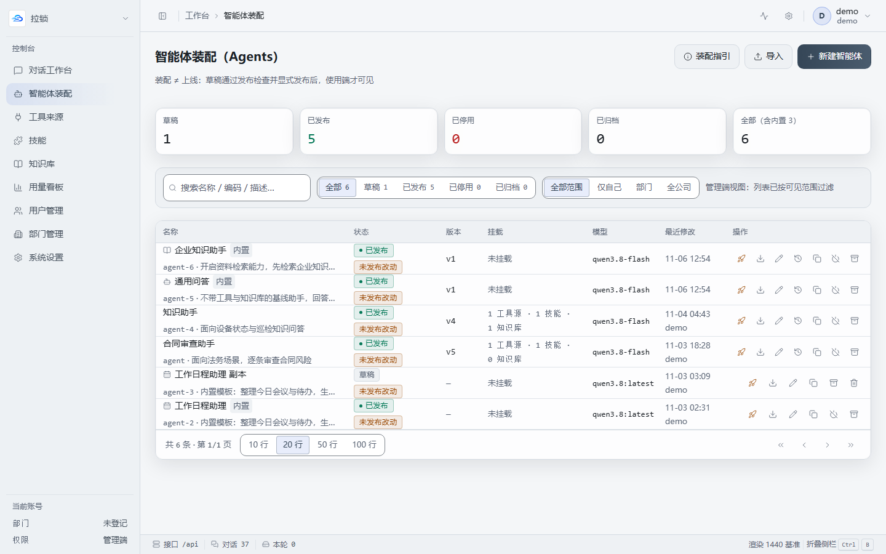
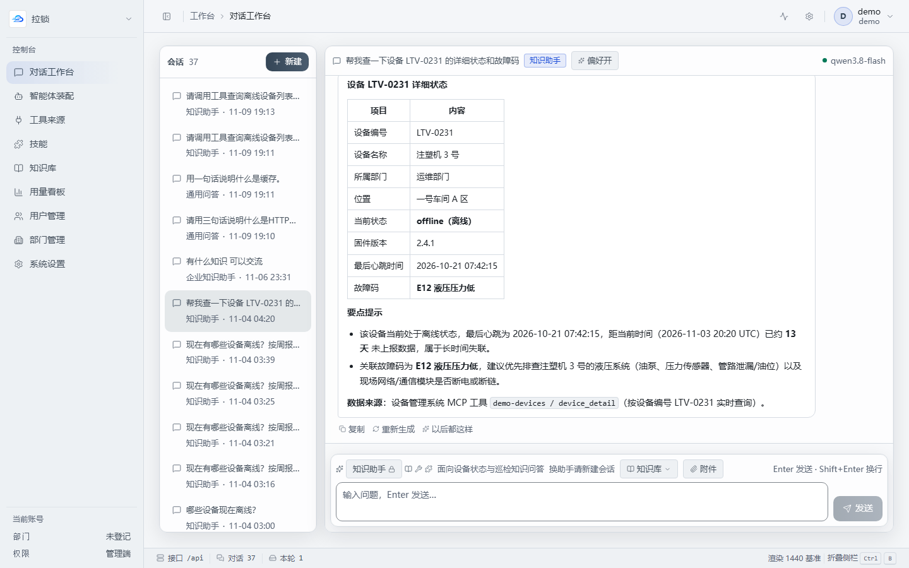
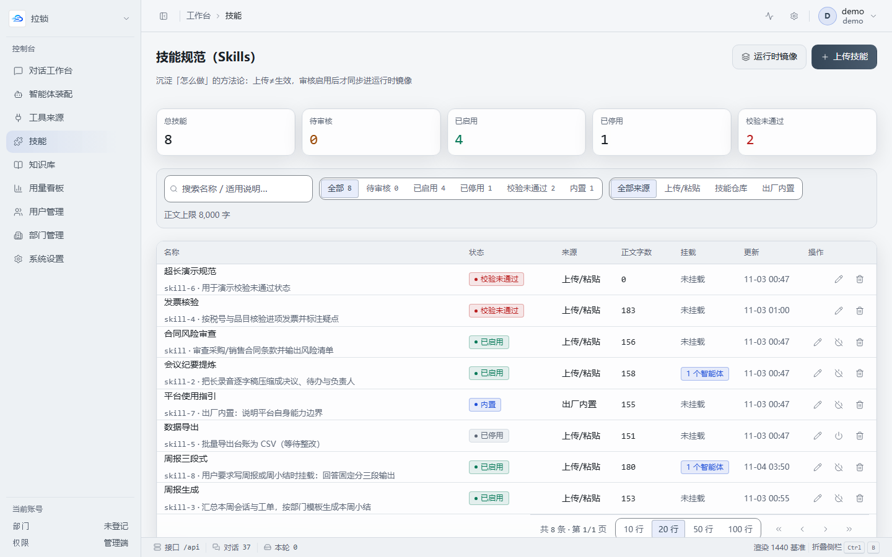
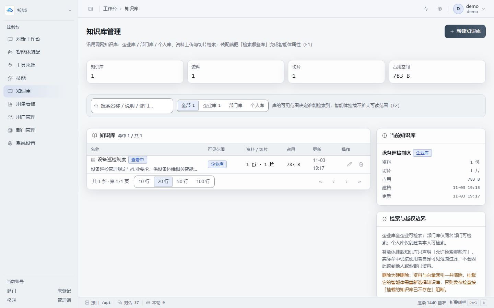
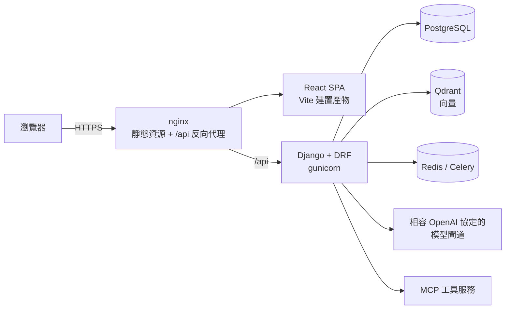

# Lasso — 企業級智慧體平台

[English](README.md) · [简体中文](README.zh-CN.md) · **繁體中文** · [日本語](README.ja.md) · [Русский](README.ru.md)

[](LICENSE)
[](frontend/package.json)
[](https://www.python.org/)
[](https://www.djangoproject.com/)
[](https://react.dev/)
[](https://vite.dev/)

**私有化部署一套 IT 部門敢簽核放行的智慧體平台：**智慧體版本化、工具授權可治理、技能灰度可控、
稽核日誌答得出「誰改了什麼」，而且不需要 Docker。

Lasso 是面向企業的自託管智慧體管控平台。它把模型、提示詞、MCP 工具、技能與知識庫裝配成一個
**可版本化的資產**，經發布檢查後上線，並持續記錄誰能用、線上跑的是哪一版、每次工具呼叫碰了什麼。

> 以下截圖取自示範資料集。截圖中的介面語言為中文；介面文案可在應用內本地化，圖片用於說明
> 版面與操作流程。

| 智慧體裝配 | 對話工作台 |
|---|---|
|  |  |

| 技能 | 知識庫 |
|---|---|
|  |  |

---

## 為什麼要做 Lasso

大多數「智慧體平台」止步於一個對話框加一個 API Key。真正上生產之後，問題會變成組織問題：

- **這個智慧體該給哪個部門看？** 可見範圍必須能收窄，而不是預設全公司可見。
- **它能呼叫這個寫入型工具嗎？** 授權要按工具逐一給，而不是按整個工具服務放行。
- **有人改了設定，線上是不是已經生效？** 編輯與發布必須是兩個動作。
- **怎麼搬到下一套環境？** 而且不能把模型金鑰與 MCP 密鑰一起打包帶走。
- **是誰改的，它到底做了什麼？** 稽核日誌是硬性要求，不是加分項。

Lasso 把這些問題的答案做成產品能力，而不是靠口頭約定。

## 核心能力矩陣

| 能力 | 具體行為 |
|---|---|
| **版本化智慧體** | 模型、提示詞、工具、技能與知識庫裝配成一個智慧體；每次發布產生不可變版本，並給出欄位級差異；未發布的修改不會到達使用者。 |
| **發布前檢查** | 上線前跑阻斷項與告警項清單；版本回滾同樣重走這份清單，並產生新版本，而不是覆蓋歷史。 |
| **MCP 工具治理與出網開關** | 登記工具來源、發現工具，再按工具逐一授權，四檔（白名單 / 自動放行 / 逐次詢問 / 唯讀）。平台級出網總開關搭配依來源的網域白名單，決定智慧體能否存取外部網路；工具呼叫內容入库前脫敏。 |
| **敏感內容遮罩與展開留痕** | 工具呼叫參數與結果依原文入库，展示層對密鑰、權杖、口令等敏感值打碼；展開原文是顯式動作，會寫入一筆 `sensitive_reveal` 稽核（操作人、目標欄位、遮罩欄位數），不會出現「看了卻查不到」。 |
| **技能灰度與指定使用者** | 技能以 `SKILL.md` 套件管理並需要審核。可見範圍由部門範圍、穩定百分比灰度（同一使用者恆定命中同一桶）與指定使用者白名單疊加；管理員始終能看到技能是否啟用、灰度比例是多少。 |
| **知識庫與檢索** | 文件入库、切片、向量檢索；每個智慧體宣告可檢索哪些知識庫，實際命中結果仍按使用者自身可見範圍過濾。 |
| **OCR 文件入库** | PDF 與圖片逐頁判定：有真實文字層的頁面直接提取，缺文字層或過短的頁面走 OCR——優先使用已設定的多模態模型，本機 tesseract 兜底。每份文件保留 `extraction_report`（逐頁標註文字層 / OCR / 未解析）與切片級頁碼、OCR 標記；全部頁面都失敗時文件標記為失敗，不會出現零切片的「已完成」。 |
| **按資源綁定網路代理** | 平台級 HTTP / SOCKS5 代理條目，密碼加密且只寫不讀。代理按資源綁定——SearXNG 引擎、天工抓取網域或來源站。套用綁定會備份並寫入線上 SearXNG 設定、重啟並做健康檢查；新設定失敗時自動回滾到上一份，未生效的綁定在介面上明確標註。 |
| **女媧模式（一句話建立智慧體）** | 一段自然語言需求生成可編輯骨架（名稱、定位、系統提示詞、模型檔位、可見範圍、歡迎語），同時比對公開 MCP 工具來源與技能，並依描述抓取參考資料寫入知識庫。產物固定為草稿；每一步都可中斷、恢復、修改。 |
| **工具與技能市場** | 「工具」「技能」兩個選單各含兩個分頁：本機來源清單與公開市場檢索。市場支援清單、搜尋、依來源與可信度篩選、詳情卡片與就地提交匯入申請；舊 `/market/*` 連結自動跳到對應分頁。 |
| **天工模式（四層檢索）** | 每個知識庫按嚴格順序跑一條發現鏈：**L1** 管理員確認的 MCP 搜尋綁定、**L2** SearXNG（預設開啟）、**L3** Bing 無頭瀏覽器兜底（預設關閉，可選 Playwright）、**L4** 來源庫抓取。搜尋層只產生候選提案，管理員批准後站點才進入來源庫並允許抓正文；抓取遵守 robots.txt、Crawl-delay、公網 HTTPS 與私網防護、單輪頁數上限，每輪如實記錄命中層與其餘層被跳過的原因。 |
| **獨立的知識庫 worker** | 文件解析、OCR 與天工採集走獨立的 `knowledge` Celery 佇列與獨立 systemd worker，大文件入库不會拖垮互動請求。 |
| **全鏈路稽核** | 發布、回滾、匯入審批、權限變更、管理員重設密碼、登入事件、出網判定等動作，全部寫入稽核日誌，記錄操作人、IP 與 User-Agent。 |
| **SSE 串流對話** | 透過 SSE 串流輸出回答，引用回到知識切片，顯示工具呼叫時間軸，支援停止與重新產生、歷史會話、附件與逐輪 token 統計。 |
| **跨環境匯出匯入** | 匯出包不含模型金鑰、MCP 密鑰與權杖；匯入是單級審批請求，必須由**另一位管理員**審批通過後才入库。 |
| **部門樹與兩級角色** | 部門層級、三種可見範圍（全公司 / 指定部門 / 僅管理端），以及嚴格區分的普通使用者與管理員。 |

## 女媧模式與工具／技能市場

女媧模式把一段自然語言變成可用的智慧體草稿，它不會替你發布。

| 步驟 | 系統做什麼 | 可編輯 |
|---|---|---|
| 1. 描述 | 你寫清楚智慧體做什麼、給誰用、要輸出什麼。 | 需求描述、使用對象、面對部門 |
| 2. 骨架 | 產生名稱、slug、定位、系統提示詞、模型檔位、可見範圍與歡迎語。 | 每一個欄位 |
| 3. 工具與技能 | 依描述比對並排序公開 MCP 工具來源與技能；每個候選都標出能力摘要、是否需要出網、是否含腳本與授權條款。 | 勾選要掛載的項目 |
| 4. 資料 | 線上抓取參考資料，清洗、去重後逐條顯示抓取狀態，確認後才寫入。 | 勾選入库的頁面、目標知識庫 |
| 5. 草稿 | 以**草稿**狀態建立智慧體，帶上已選掛載與知識庫。 | 裝配頁裡的全部內容 |

**一個選單兩個分頁。**「工具」（`/mcp`）與「技能」（`/skills`）各含兩個分頁——本機來源清單
與公開市場。市場支援清單、搜尋、依來源與可信度篩選、詳情卡片與就地提交匯入申請；舊 `/market/mcp`、
`/market/skills` 會跳到對應分頁。兩個分頁與嚮導第三步使用同一套檢索服務與同一條匯入申請，只有一套
邏輯、一條審批口徑。

**線上優先，本機兜底。** `nuwa_market_online` 預設開啟：檢索直連公開 registry 與技能倉庫，命中的
項目同時寫入本機目錄。網路失敗、逾時、被封鎖或管理員關閉開關時，頁面回落到本機副本並標註來源：
`mode` 為 `online` / `mixed` / `cached`，`degraded_reason` 說明原因（`switch_off`、`timeout`、
`network_error`、`rate_limited`、`http_error`、`offline_no_cache`），同時顯示快取同步日期；不報錯、
不空白。

**兩組互不影響的開關。** 女媧出網（`nuwa_market_online`、`nuwa_knowledge_online`）只服務市場檢索與
資料抓取；智慧體執行時的工具出網是另一個開關（`mcp_egress_enabled`）。關掉其中一個不會影響另一個。
管理員可透過 `GET|POST /api/nuwa/switches/` 檢視與切換女媧開關。

**審批口徑不變。** 公開市場抓到的一律是外部內容：匯入是單級申請，提交人不能審批自己的申請；審批
通過的 MCP 來源入库為 `unknown` 且**工具全關**；技能入库為 `pending`，審核通過前不進執行時。女媧
產物固定為草稿，發布仍走正常的發布前檢查。

```bash
# 線上重新整理本機市場目錄
python manage.py nuwa_sync

# 在有外網的機器匯出目錄包，再在內網匯入（全程不出網）
python manage.py nuwa_sync --export data/nuwa/market-cache.json
python manage.py nuwa_sync --import data/nuwa/market-cache.json
```

## 天工模式：四層知識發現

天工（取「天工開物」之意）是知識庫級的採集器。建庫時勾選「取得相關知識」，平台就會自己找資料；
開關建庫後仍可修改，且只影響之後的採集。

**四層一條鏈。** 每輪按嚴格順序執行，命中足夠可用的結果即停止：

| 層 | 做什麼 | 預設 |
|---|---|---|
| **L1 MCP 搜尋** | 呼叫管理員從已登記 MCP 伺服器中明確確認的搜尋工具，可設定 query / limit / 結果欄位映射、優先順序，並支援單條測試；不硬編碼任何廠商，也不會自動啟用工具。 | 確認綁定後才生效 |
| **L2 SearXNG** | 查詢本機 SearXNG JSON 介面，帶逾時、限速與熔斷。 | 開啟 |
| **L3 Bing 兜底** | 由 Playwright 驅動的無頭 Chromium 只查 Bing；不解析其他引擎，也不繞過驗證碼或風控——遇到驗證碼或 HTTP 429 即記為失敗並當日熔斷 24 小時。瀏覽器是可選部署前置，本層預設關閉，缺依賴時跳過並給出可讀原因。 | 關閉 |
| **L4 來源庫** | 抓取已批准來源與知識庫臨時採集入口，遵守 robots.txt 與 Crawl-delay，同一主機串行、單輪頁數有上限，並依 URL 與正文指紋去重。 | 開啟 |

**搜尋只產候選，不產文件。** L1–L3 只寫 `TiangongSourceProposal`（`discovered_by` 為 `mcp` /
`searxng` / `bing`）。管理員逐條批准或拒絕；批准時建立或合併 `TiangongSource`，只有啟用的來源才會在
L4 被抓取，未批准的 URL 不會被抓進知識庫。每輪落一筆 `TiangongRun`，記錄降級鏈（層、結果、原因、
筆數、耗時）與一筆聚合稽核，不按 URL 逐條記。

**私網防護。** 候選位址必須是公網 HTTPS；DNS 只用 IPv4 解析，私網、環回、鏈路本地與內網主機一律
拒絕，真實連線時再校驗一次。設定代理時按資源綁定——SearXNG 引擎、天工抓取網域或來源站——密碼加密，
讀介面不回顯、稽核不落明文。

**有上限、可解釋。** 單輪最多 5 篇網頁 + 1 篇模型整理稿，之後手動「補充採集」。模型整理稿帶
`source_type='model'` 與生成模型名，不冒充原始出處。無外網 → 只走模型側；模型未設定 → 只走網頁側；
開關關閉 → 跳過並寫明原因；都不可用 → 記為失敗並給出可讀原因。知識庫照常可用，介面不返回 500。

**權限與獨立開關。** 只有庫主或平台管理員能開關與觸發。`tiangong_enabled`、`tiangong_online` 與
各搜尋層開關只管天工，不讀取 `nuwa_market_online` / `nuwa_knowledge_online`，與工具出網
`mcp_egress_enabled` 也互不影響；只有網域白名單作為安全邊界共用。管理員透過
`GET|POST /api/knowledge/tiangong/switches/` 管理總開關，透過
`GET|POST /api/knowledge/tiangong-search/settings/` 管理搜尋層。

## 架構



| 層 | 技術選型 |
|---|---|
| 前端 | React 19.2、TypeScript 6、Vite 8.3、Tailwind CSS 4.3、TanStack Query 5、Zustand 5 |
| 後端 | Django 5.2（5.2.17）、Django REST Framework 3.18、SimpleJWT、gunicorn 23 |
| 資料 | PostgreSQL 14+（本機開發可用 SQLite）、Qdrant 1.19（選用）、Redis / Celery（選用） |
| 整合 | 任意相容 OpenAI Chat Completions 的閘道、MCP 工具服務 |

`backend/apps/` 下共 11 個 Django 模組承載領域邏輯：`agenthub`、`agents`、`chat`、`skills`、
`knowledge`、`mcp`、`nuwa`、`users`、`settings`、`usage`，以及共用工具 `common`。

## 快速開始（5 分鐘）

**環境需求：** Python 3.11+、Node.js 20+，資料庫用預設 SQLite 或 PostgreSQL 14+ 都可以。
起步階段不需要 Docker、不需要訊息佇列，也不需要向量資料庫。

### 1. 安裝後端

```bash
python -m venv .venv
source .venv/bin/activate          # Windows: .venv\Scripts\activate
pip install -r requirements.txt
```

### 2. 初始化資料庫

```bash
cp .env.example .env               # 然後依實際環境填寫
python manage.py migrate
python manage.py createsuperuser
python manage.py init_builtin_agents   # 選用：初始化內建智慧體
```

### 3. 啟動 API

```bash
python manage.py runserver 127.0.0.1:8000
```

### 4. 啟動主控台

```bash
cd frontend
npm ci
npm run dev                        # http://localhost:5173，/api 代理到 :8000
```

開啟 <http://localhost:5173>，用剛建立的管理員帳號登入。

### 5. 裝配第一個智慧體

1. 進入**智慧體裝配**，點**新建智慧體**。
2. 選擇模型（先在**系統設定**裡設定並驗證閘道），填寫提示詞，掛載需要的工具、技能與知識庫。
3. 跑一遍發布前檢查，發布，確認新版本（不可變）出現在版本清單裡。
4. 進入**對話工作台**，選擇該智慧體送出第一則訊息；回答、引用來源與工具呼叫時間軸都會留在會話裡。

生產建置：執行 `cd frontend && npm run build`，把 `frontend/dist` 交給 nginx 託管。

### 6. 試試女媧模式與合併後的市場

1. 側欄只有兩個目錄入口：**工具**與**技能**。每個頁面兩個分頁——本機清單與公開市場；舊
   `/market/mcp`、`/market/skills` 會跳到對應分頁。
2. 在**智慧體裝配**頁選擇**女媧模式**，用一段話描述需求，依五步走完：骨架 → 工具與技能 → 參考資料 → 草稿。
3. 從公開市場勾選的項目會先落**待審批**，需另一位管理員審批：MCP 來源入库為 `unknown` 且工具全關，
   技能入库為 `pending`。
4. 內網機器沒有外網時，在有外網的環境匯出目錄包，再在內網匯入；市場分頁會繼續用本機副本工作，
   並標註降級原因。

```bash
python manage.py nuwa_sync                                        # 線上重新整理
python manage.py nuwa_sync --export data/nuwa/market-cache.json   # 有外網的機器
python manage.py nuwa_sync --import data/nuwa/market-cache.json   # 內網匯入
```

### 7. 試試天工模式

1. 在**知識庫**點**新建知識庫**，開啟**取得相關知識**（天工模式）。
2. 填**採集主題**（可選，預設用名稱與說明）與**採集入口**（可選，最多 5 個 URL），儲存後自動跑首輪。
3. 進入天工頁面的三個分頁：**來源庫**（已批准來源）、**候選來源**（待審批提案）與**搜尋與抓取**
   （各層開關與參數）。L2 SearXNG 預設開啟；L1 需要先確認 MCP 搜尋綁定；L3 Bing 預設關閉，需先在
   伺服器安裝可選的 Playwright 瀏覽器。
4. 批准你信任的候選；下一輪只抓已批准來源並匯入正文，每筆資料標「外部網頁」或「模型生成」。
5. 某一搜尋層失敗時，採集記錄會寫明該層與原因，並繼續抓取來源庫；天工開關與女媧出網開關互不影響。


## 設定

執行期設定全部來自環境變數或本機 `.env`。複製 [`.env.example`](.env.example) 後填入自己的值：
該檔案只包含佔位值，逐項說明了每個變數的含義，且刻意不含任何真實主機、金鑰或帳號。

| 分組 | 變數 | 說明 |
|---|---|---|
| 基礎 | `SECRET_KEY`、`DEBUG`、`ALLOWED_HOSTS`、`ALLOW_REGISTER` | `SECRET_KEY` 每套環境必須不同 |
| 認證 | `JWT_SIGNING_KEY`、`JWT_*_LIFETIME_*`、`LOGIN_FAILURE_*`、`AUTH_TRUSTED_PROXIES` | 輪換簽章金鑰會使已簽發權杖失效 |
| 資料庫 | `DB_ENGINE`、`DB_NAME`、`DB_USER`、`DB_PASSWORD`、`DB_HOST`、`DB_PORT` | 預設 `sqlite3`，共用環境建議 PostgreSQL |
| 靜態加密 | `MCP_SECRET_KEY` | 加密儲存的 MCP 憑證，永不隨匯出包外帶 |
| 檢索 | `VECTOR_STORE`、`QDRANT_*`、`FASTEMBED_*` | 本機開發可不啟 Qdrant |
| 非同步 | `CELERY_BROKER_URL`、`CELERY_RESULT_BACKEND`、`CELERY_TASK_*` | 沒有 broker 時可用 eager 模式 |
| 模型 | `LLM_BASE_URL`、`LLM_API_KEY`、`LLM_MODEL`、`LLM_*` | 相容 OpenAI 協定；也可在管理端設定 |

## 與常見方案的比較

比較只做定性判斷，聚焦本專案關注的能力維度；前兩欄描述的是這兩類方案的**典型形態**，
不針對任何具體產品。

| 維度 | 典型對話型智慧體框架 | 典型 SaaS 智慧體平台 | Lasso |
|---|---|---|---|
| 帶發布檢查的智慧體版本 | — | 部分 | 支援 |
| 按工具授權與平台出網開關 | — | 部分 | 支援 |
| 技能灰度比例與指定使用者白名單 | — | — | 支援 |
| 產品內的部門級可見範圍 | — | 部分 | 支援 |
| 需另一位管理員審批的匯入 | — | — | 支援 |
| 涵蓋發布、權限與出網的稽核日誌 | 部分 | 部分 | 支援 |
| 自有主機部署且不依賴 Docker | 支援 | 不支援 | 支援 |
| 可替換的模型閘道 | 支援 | 部分 | 支援 |

## 部署形態

參考部署是裸機方案：**nginx** 託管靜態資源並反向代理 `/api`，**gunicorn** 由 **systemd** 託管，
資料庫用 **PostgreSQL 14+**，Redis / Celery 與 Qdrant 依需啟用。**不依賴也不使用 Docker。**

- `deploy/nginx/` —— API 與媒體端點的 server 片段，以及參考 `nginx.conf`。
- `deploy/systemd/lasso.service` —— gunicorn 的服務單元，含重啟策略與 journald 日誌。
- `deploy/systemd/lasso-knowledge-worker.service` —— `knowledge` 佇列專用 worker（解析、OCR 與天工採集）。
- `deploy/searxng/` —— L2 使用的 SearXNG 安裝與設定參考。
- `deploy/ops/install_ocr.sh` —— 可選的本機 tesseract OCR 兜底。
- `deploy/install_playwright.sh` —— L3 Bing 兜底可選的 Playwright + Chromium 前置。
- [docs/DEPLOYMENT.md](docs/DEPLOYMENT.md) —— 逐步驟的設定、遷移與常見問題說明。

## 專案結構

```
agent-platform/
├── backend/                 Django 工程
│   ├── apps/agenthub/       智慧體、版本、發布、匯入請求
│   ├── apps/agents/         智慧體執行時、工具註冊表、橋接
│   ├── apps/chat/           會話、串流輸出、工具呼叫
│   ├── apps/skills/         技能套件、灰度、掛載
│   ├── apps/knowledge/      知識庫、文件、檢索、天工發現與 OCR
│   ├── apps/mcp/            工具來源、探索、憑證、示範服務
│   ├── apps/users/          帳號、部門、稽核日誌
│   ├── apps/settings/       平台設定與模型連通性
│   ├── apps/usage/          token 用量與分析
│   ├── apps/nuwa/           女媧模式：市場目錄、嚮導會話、匯入申請
│   └── apps/common/         共用的模型、向量與媒體工具
├── frontend/                React + Vite 單頁應用
│   └── src/pages/           智慧體（含女媧）、對話、工具（含市場）、技能（含市場）、知識庫、使用者、設定
├── deploy/                  nginx、systemd、SearXNG 與 OCR / Playwright 輔助腳本
├── docs/                    API 參考、權限矩陣、部署指南、截圖
├── .env.example             設定範本
└── requirements.txt
```

## 文件索引

| 文件 | 內容 |
|---|---|
| [docs/DEPLOYMENT.md](docs/DEPLOYMENT.md) | 生產部署、設定與故障排查 |
| [docs/api-reference.md](docs/api-reference.md) | REST API 介面參考 |
| [docs/auth-permission-matrix.md](docs/auth-permission-matrix.md) | 認證、角色與物件級權限 |
| [docs/assets/screenshots/README.md](docs/assets/screenshots/README.md) | 截圖規範與脫敏清單 |
| [CONTRIBUTING.md](CONTRIBUTING.md) | 如何提改動、如何開 PR |
| [SECURITY.md](SECURITY.md) | 漏洞私密回報管道與加固清單 |
| [CODE_OF_CONDUCT.md](CODE_OF_CONDUCT.md) | 社群行為準則與處理方式 |
| [docs/design/nuwa-mode.md](docs/design/nuwa-mode.md) | 女媧模式與市場設計：開關、降級路徑與審批口徑（中文） |
| [.env.example](.env.example) | 全部支援的環境變數，只含佔位值 |

## 參與貢獻

歡迎貢獻，請先看 [CONTRIBUTING.md](CONTRIBUTING.md) 與[行為準則](CODE_OF_CONDUCT.md)。
安全問題請依 [SECURITY.md](SECURITY.md) 描述的方式私下回報，不要開公開 issue。

## 授權條款

採用 **Apache License 2.0**，全文見 [LICENSE](LICENSE)。

- 允許商用、修改、散布與私有使用。
- 必須保留版權聲明、授權條文與隨附的 `NOTICE` 檔案，並在修改過的檔案中說明改動。
- 軟體**不提供任何形式的擔保**，作者不對由此產生的損失承擔責任。
- Apache-2.0 同時授予明確的專利授權，並要求不得使用本專案商標為衍生產品的背書。

Copyright 2026 Lasso contributors.